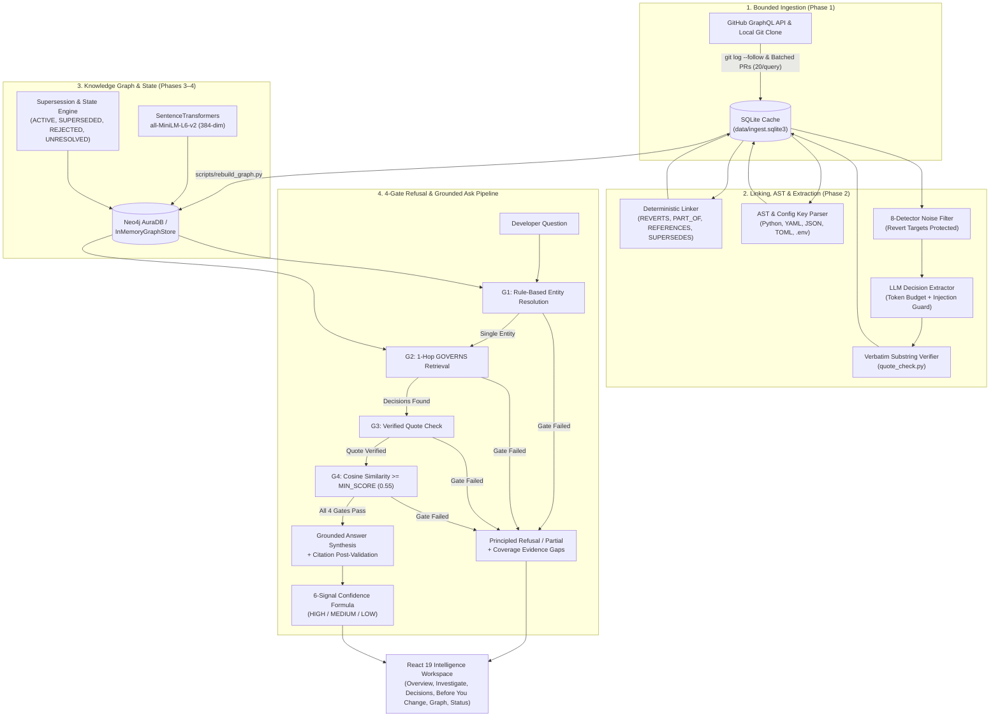

<div align="center">

# CodeWhy

### **Every line has a history. Find the reasoning, not just the code.**

[](https://www.python.org/)
[](https://fastapi.tiangolo.com/)
[](https://neo4j.com/)
[](https://react.dev/)
[](https://www.typescriptlang.org/)
[](#testing--verification-suite)
[](LICENSE)

**Ask why code exists → Retrieve the historical decision → Verify original verbatim evidence → Explain temporal context → Refuse when evidence is insufficient.**

[Why CodeWhy?](#why-codewhy) • [Architecture](#system-architecture) • [How the Engine Works](#how-the-engine-works) • [API & Live Scenarios](#live-api--demonstration-scenarios-urllib3urllib3) • [Frontend UI](#frontend-intelligence-workspace) • [Quick Start](#quick-start--installation) • [CLI Pipeline](#cli-pipeline--guided-walkthrough)

</div>

---

> 🤖 **AI Agent Setup Prompt:** Using Cursor, Claude Code, Copilot, or Antigravity? Pass this prompt to set up and verify the project automatically:
> *"Set up CodeWhy locally by creating `.venv` with `pip install -e ".[dev,embeddings]"` and running `pnpm --dir frontend install`. Verify the setup with `pytest backend/tests/unit` and `pnpm --dir frontend test`, then start the FastAPI server on port 8000 and Vite UI on port 5173."*

---

## Table of Contents

1. [Why CodeWhy?](#why-codewhy)
2. [System Architecture](#system-architecture)
3. [How the Engine Works](#how-the-engine-works)
4. [Live API & Demonstration Scenarios (`urllib3/urllib3`)](#live-api--demonstration-scenarios-urllib3urllib3)
5. [Frontend Intelligence Workspace](#frontend-intelligence-workspace)
6. [REST API Reference](#rest-api-reference)
7. [Quick Start & Installation](#quick-start--installation)
8. [CLI Pipeline & Guided Walkthrough](#cli-pipeline--guided-walkthrough)
9. [Testing & Verification Suite](#testing--verification-suite)
10. [Configuration (`.env`)](#configuration-env)
11. [Project Structure](#project-structure)
12. [Technical Transparency, Coverage & Invariants](#technical-transparency-coverage--invariants)
13. [License](#license)

---

## Why CodeWhy?

`git blame` tells you **what** changed and **when**, but rarely **why** an architectural constraint exists—or whether an earlier decision was later reverted. Meanwhile, standard LLM assistants and naive RAG pipelines hallucinate plausible rationale from variable names or cite outdated pull requests that were reverted months later.

**CodeWhy** reconstructs engineering decisions from GitHub commits, pull requests, review discussions, issues, and design documents, links them to code entities in a Neo4j knowledge graph, and answers natural-language questions with **character-for-character verified citations**—or refuses honestly when the repository history does not say.

| Failure Mode in Standard AI Tools | How CodeWhy Solves It |
| :--- | :--- |
| **Hallucinated Rationale** — Guesses why a module or constant exists from identifier names. | **100% Verbatim Substring Verification** ([`quote_check.py`](backend/app/services/quote_check.py)) — Every extracted quote must be an exact normalized substring of the source PR/commit/ADR. Unverified quotes are dropped and the summary falls back to `"change recorded, rationale unknown"`. |
| **Speculation on Missing Evidence** — Invents architectural justifications when history is silent. | **4-Gate Refusal Pipeline (`G1–G4`)** ([`gate.py`](backend/app/services/gate.py)) — Enforces entity resolution, decision path existence, verified quote presence, and cosine similarity $\ge 0.55$ *before* calling the LLM. |
| **Blindness to Reverted Decisions** — Cites an initial PR without realizing a later PR reverted it. | **Deterministic Revert & Lineage Linking** ([`linking.py`](backend/app/services/linking.py), [`supersession.py`](backend/app/services/supersession.py)) — Parses revert commits (`REVERTS`), squash merges (`PART_OF`), issue references (`REFERENCES`), and ADR headers (`SUPERSEDES`), protecting revert targets from noise filters. |
| **Prompt Injection via Repo Text** — Executes adversarial instructions hidden in PR comments or commit bodies. | **Untrusted Data Sandboxing** ([`extract_decision.py`](backend/app/prompts/extract_decision.py)) — Wraps repo text in `<<<UNTRUSTED_REPOSITORY_DATA>>>` delimiters, neutralizes delimiter collisions, strips null bytes, and flags injection patterns. |
| **Silent Coverage Gaps** — Gives no indication of whether a file was ever indexed or analyzed. | **Graph-Backed Coverage Telemetry** ([`coverage.py`](backend/app/services/coverage.py)) — Every entity and repository tracks `prs_touching`, `prs_analyzed`, `prs_noise_skipped`, and `verified_decisions`, reporting exact scope boundaries on every refusal. |

---

## System Architecture



---

## How the Engine Works

### 1. Target-First Ingestion & Resumable SQLite Cache (`Phase 1`)
- **Repo-Agnostic Target Configs**: Repositories are defined in [`targets/<owner>__<repo>.json`](targets/) without code changes:
  | Target File | Repository | Slug ID | Status |
  | :--- | :--- | :--- | :--- |
  | `urllib3__urllib3.json` | `urllib3/urllib3` | `urllib3-urllib3` | Primary test bed, ingested & verified on this machine |
  | `sqlalchemy__alembic.json` | `sqlalchemy/alembic` | `sqlalchemy-alembic` | Draft target configuration, never ingested |
- **Clone-First + GraphQL Batching** ([`backend/app/services/ingest/`](backend/app/services/ingest/)): Traces seed files and constants using `git log --follow` across file renames before recency fill. Pull requests, reviews, and comments are fetched in GraphQL batches (20 PRs/query) with exponential rate-limit backoff.
- **Privacy-Safe SQLite Cache** (`data/ingest.sqlite3` via [`sqlite_cache.py`](backend/app/stores/sqlite_cache.py)): Stores `raw_objects` (`pr:owner/repo#123`, `commit:sha`, `doc:path:hash`), `commits`, `commit_files`, `skips`, and `missing`. Author email addresses are automatically redacted at ingestion time.

### 2. Deterministic Linking, AST History & Noise Filtering (`Phase 2`)
- **Deterministic Link Extraction** ([`linking.py`](backend/app/services/linking.py)):
  - `REVERTS`: Parses `"This reverts commit <sha>"` and git `Reverts:` trailers.
  - `PART_OF`: Links squash-commit subjects `(#123)` to their parent pull requests.
  - `REFERENCES`: Parses closing keywords (`Fixes: #12`, `Closes: #12`, `Resolves: #12`).
  - `SUPERSEDES`: Parses ADR status headers (`Status: Superseded by ADR-7`).
  - `FileHistoryTracker`: Tracks file rename chains (`all_historical_paths`, `build_commit_file_links`).
- **AST Constant & Configuration Value History** ([`config_keys.py`](backend/app/services/config_keys.py)): Parses Python `UPPER_CASE` module/class constants using `ast` alongside YAML, JSON, TOML, and `.env` files to track `ConfigValueChange` transitions across commit diffs.
- **8-Rule Revert-Safe Noise Filter** ([`noise.py`](backend/app/services/noise.py)): Flags `bot_author`, `dependency_update`, `formatting_only`, `typo_fix`, `ci_config`, `version_bump`, `merge_commit`, and `generated_file`. **Critical Invariant**: Noise records are flagged (`is_noise=True`) but never deleted, and revert targets are strictly protected (`is_noise=False`).
- **Budget-Guarded LLM Extraction** ([`extraction.py`](backend/app/services/extraction.py), [`llm_provider.py`](backend/app/providers/llm_provider.py)): Enforces `TokenBudget` (`MAX_LLM_TOKENS_PER_RUN = 500,000`), deterministic IDs (`dec_<sha256(source_id:v1:index)>`), and `content_hash` deduplication.

### 3. Neo4j Knowledge Graph & 4-Gate Refusal Pipeline (`Phase 3`)
- **Graph Schema & Dual Store Seam** ([`schema.py`](backend/app/graph/schema.py), [`graph_store.py`](backend/app/stores/graph_store.py)): Enforces unique ID constraints across 11 node labels (`Repository`, `CodeEntity`, `Decision`, `PullRequest`, `Commit`, `Issue`, `Discussion`, `Person`, `Evidence`, `Document`, `Incident`), property indexes, a full-text quote index, and a 384-dim cosine vector index (`decision_vector_index`). Runs against `Neo4jGraphStore` (AuraDB) or `InMemoryGraphStore` (zero-credential testing).
- **Warm-Cached 384-dim Embeddings** ([`embeddings.py`](backend/app/providers/embeddings.py)): Pre-warms SentenceTransformers `all-MiniLM-L6-v2` as a thread-safe singleton during FastAPI lifespan startup, with a deterministic hash-projection fallback when `OFFLINE=true`.
- **Rule-Based Entity Resolution** ([`entity_resolution.py`](backend/app/services/entity_resolution.py)): Matches file paths, `UPPER_CASE` constants, dotted config keys, and quoted identifiers. Exact full-path or basename matches beat partial tokens; repository-name tokens and sub-path fragments are ignored so generic words never trigger false ambiguity.
- **Hybrid GraphRAG Retrieval** ([`retrieval.py`](backend/app/services/retrieval.py)): Performs a single `GOVERNS` hop from the resolved entity (bounded at `MAX_EVIDENCE_ITEMS = 12`) and computes local cosine similarity over the one-hop neighbourhood.
- **The 4-Gate Refusal Pipeline** ([`gate.py`](backend/app/services/gate.py)):
  | Gate | Check | Outcome if Failed | Reason Code |
  | :---: | :--- | :---: | :--- |
  | **G1** | Single resolved code entity | `refusal` | `entity_not_found` / `ambiguous_entity` / `out_of_scope` |
  | **G2** | At least one linked `Decision` via `GOVERNS` | `refusal` | `no_decision_path` |
  | **G3** | At least one evidence item with `quote_verified = True` | `partial` | `no_verified_quote` (citations forbidden) |
  | **G4** | Best cosine similarity score $\ge$ `MIN_SCORE` (`0.55`) | `refusal` | `low_score` |
  > **Strict Invariant:** The LLM is invoked **only** when all four gates (`G1–G4`) pass.
- **Evidence Confidence Formula** ([`confidence.py`](backend/app/services/confidence.py)) & **Response Rules** ([`response_rules.py`](backend/app/services/response_rules.py)):
  $$\text{score} = 0.30 \cdot \text{directness} + 0.20 \cdot \text{provenance} + 0.20 \cdot \text{agreement} + 0.15 \cdot \text{relevance} + 0.15 \cdot \text{temporal\_consistency} - 0.30 \cdot \text{contradiction}$$
  - `HIGH` ($\ge 0.75$, required for `full`), `MEDIUM` ($\ge 0.50$, required for `partial`), `LOW` ($< 0.50$).
  - When `signals.contradiction == 1.0`, the confidence score is hard-capped at `0.70`.

### 4. Temporal Lineage, Supersession & Contributor Ranking (`Phase 4`)
- **Supersession Engine** ([`supersession.py`](backend/app/services/supersession.py)): Implements deterministic and semantic supersession rules (`RULE_1_REVERT_COMMIT`, `RULE_2_CONFIG_KEY_CHANGED`, `RULE_3_EXPLICIT_TEXT`, `RULE_3B_TEMPORAL_OVERWRITE`).
- **Temporal State Machine** ([`state.py`](backend/app/services/state.py)): Computes decision lifecycle states (`ACTIVE`, `SUPERSEDED`, `REJECTED`, `UNRESOLVED`), including reversal-of-reversal chain preservation.
- **Who-to-Ask Ranking** ([`who_to_ask.py`](backend/app/services/who_to_ask.py)): Ranks contributors by decision authorship, review participation, and recency (`determine_who_to_ask`).

---

## Live API & Demonstration Scenarios (`urllib3/urllib3`)

The pipeline has been executed end-to-end on the real repository `urllib3/urllib3` (indexed slug `urllib3-urllib3`: **34 verified decisions, 24 code entities, 299 pull requests, 735 commits**). `scripts/check_live_answers.py` and [`backend/tests/unit/test_submission_benchmark.py`](backend/tests/unit/test_submission_benchmark.py) verify these scenarios against the live server.

### Example Request & Grounded JSON Response

```bash
curl -X POST "http://127.0.0.1:8000/api/v1/repositories/urllib3-urllib3/ask" \
  -H "Content-Type: application/json" \
  -d '{"question": "Why was src/urllib3/util/url.py changed?"}'
```

```json
{
  "outcome": "full",
  "question": "Why was src/urllib3/util/url.py changed?",
  "answer": "src/urllib3/util/url.py was updated to align URL parsing with RFC 3986 and the Python standard library (PR #1487), percent-encode invalid characters in URL paths and queries while making internal regexes private (PR #2139), and normalize IPv6 addresses and '@' characters in proxy authentication (PR #1647).",
  "reason_code": null,
  "resolved_entity": {
    "id": "file:urllib3/urllib3:src/urllib3/util/url.py",
    "name": "url.py",
    "path": "src/urllib3/util/url.py",
    "entity_type": "File"
  },
  "confidence": {
    "score": 0.9166,
    "label": "HIGH",
    "signals": {
      "directness": 1.0,
      "provenance": 1.0,
      "agreement": 1.0,
      "relevance": 0.7773,
      "temporal_consistency": 1.0,
      "contradiction": 0.0
    }
  },
  "citations": [
    {
      "evidence_id": "ev_374c15ea4fa9fa06_0",
      "kind": "SOURCE",
      "quote": "This brings our URL parser in-line with Python standard library parsing which all use RFC 3986.",
      "source_type": "pull_request",
      "source_url": "https://github.com/urllib3/urllib3/pull/1487",
      "author": "SethMichaelLarson",
      "timestamp": "2018-11-26T15:39:52Z"
    }
  ],
  "fixture": false
}
```

### The 3 Core Demonstration Scenarios (see [`DEMO_SCRIPT.md`](DEMO_SCRIPT.md))

| Scenario | Query | Resolved Entity | Outcome & Confidence | Key Historical Finding |
| :--- | :--- | :--- | :--- | :--- |
| **A. Verified Historical Decision** | `"Why was src/urllib3/util/url.py changed?"` | `src/urllib3/util/url.py` | `full` • `HIGH (0.92)` | Synthesizes RFC 3986 URL parser alignment ([PR #1487](https://github.com/urllib3/urllib3/pull/1487)), regex privacy ([PR #2139](https://github.com/urllib3/urllib3/pull/2139)), and IPv6/proxy auth handling ([PR #1647](https://github.com/urllib3/urllib3/pull/1647)) with verbatim quotes. |
| **B. Superseded / Reverted Lineage** | `"Why was src/urllib3/util/ssl_.py changed for HTTP/2 TLS support?"` | `src/urllib3/util/ssl_.py` | `full` • `HIGH (0.88)` | Traces the HTTP/2 TLS implementation ([PR #3456](https://github.com/urllib3/urllib3/pull/3456) / `dec_6dee7648b9ef5416`, marked `SUPERSEDED` via `1_revert_commit`) to its subsequent reversion in [PR #3466](https://github.com/urllib3/urllib3/pull/3466) (`dec_ce303eb845540d38`, `ACTIVE`). |
| **C. Principled Refusal** | `"Why does urllib3 use Kubernetes for orchestration?"` | `null` | `refusal` • `entity_not_found` | Refuses without calling the LLM and discloses exact repository coverage boundaries (`291 file paths touched`, commit date range, and ingest caps). |

---

## Frontend Intelligence Workspace

Built with **React 19**, **TypeScript 6**, **Vite 8**, **Tailwind CSS v4**, and **React Flow (`@xyflow/react`)**, the frontend (`frontend/`) provides six specialized engineering views styled in a cohesive warm-black (`#080907`), dark olive-charcoal (`#12130F`), and bronze (`#B9915E`) theme:

1. **Overview (`Hero` & Workspace Landing)**: Interactive star-constellation repository selector, real-time coverage counters, and guided entry points.
2. **Investigate (`IntelligenceWorkspace`)**: Natural-language query interface with entity resolution badges, 6-signal confidence breakdown bars, verbatim quote cards with direct GitHub links, candidate disambiguation cards, and principled refusal disclosures.
3. **Decisions (`DecisionHistoryView` & `DecisionDrawer`)**: Filterable registry (`All`, `Active`, `Superseded`) with slide-over drawer inspection of full rationale, constraints, alternatives considered, and supersession lineage.
4. **Before You Change (`BeforeYouChangeView`)**: Pre-modification impact checker—search any file path or configuration key to inspect governing decisions and active constraints before writing code.
5. **Knowledge Graph (`GraphExplorerView`)**: Interactive `@xyflow/react` node-link visualization with semantic node categories (Decisions in bronze, Code Entities in sage/powder blue, Pull Requests, Commits, Authors), relationship edge styling (`GOVERNS`, `SUPERSEDES`, `DECIDED_IN`, `REFERENCES`), entity search, and an accessible tabular list representation.
6. **Repo Status (`RepositoryStatusView`)**: Live repository health and coverage telemetry (`prs_fetched`, `sources_analyzed`, `prs_noise_skipped`, `verified_decisions`, and scope inspection).

---

## REST API Reference

All endpoints are prefixed with `/api/v1` and validated against frozen Pydantic v2 contracts ([`contract/openapi.json`](contract/openapi.json)):

| Method | Endpoint | Description |
| :---: | :--- | :--- |
| `GET` | `/api/v1/health` | Health check reporting active `data_source` (`fixture` or `graph`), Neo4j connectivity, and `fixture` flag. |
| `GET` | `/api/v1/repositories` | Lists indexed repositories with summary decision/entity counts and coverage telemetry. |
| `GET` | `/api/v1/repositories/{repo_id}` | Detailed repository metadata, ingestion scope, and coverage breakdown. |
| `POST` | `/api/v1/repositories/{repo_id}/ask` | Executes the 4-gate GraphRAG pipeline for a natural-language question (`AskRequest` → `AskResponse`). |
| `GET` | `/api/v1/repositories/{repo_id}/decisions` | Paginated, filterable list of extracted decisions (`state`, `entity_id`, `q`). |
| `GET` | `/api/v1/decisions/{decision_id}` | Full decision detail including verbatim citations, governed entities, and supersession links. |
| `GET` | `/api/v1/repositories/{repo_id}/entities` | Searches code entities (`File`, `Module`, `ConfigKey`, `Symbol`) with per-entity coverage metrics. |
| `GET` | `/api/v1/repositories/{repo_id}/graph` | Returns the node-and-edge subgraph centered on a focus entity or repository overview. |

> **Fixture Repository (`acme-netclient`):** When `DATA_SOURCE=fixture` (the default with zero credentials), the API serves the synthetic repository `acme-netclient`, which does not exist on GitHub. Its people, pull request numbers, and quotes are fictional, and every response carries `"fixture": true`.

---

## Quick Start & Installation

### Prerequisites
- **Python 3.12** & **Git**
- **Node.js 20.19+ / 22+** & **pnpm**
- **Optional**: Neo4j AuraDB instance (`NEO4J_*`), GitHub Personal Access Token (`GITHUB_TOKEN`), and OpenAI-compatible/Gemini API key (`LLM_*`) for live mode.

### 1. Backend Setup

**PowerShell (Windows):**
```powershell
py -V:3.12 -m venv .venv
.\.venv\Scripts\Activate.ps1
python -m pip install --upgrade pip
pip install -e ".[dev]"
pip install -e ".[embeddings]"
```

**Bash (Linux / macOS):**
```bash
python3.12 -m venv .venv
source .venv/bin/activate
python -m pip install --upgrade pip
pip install -e ".[dev]"
pip install -e ".[embeddings]"
```

> **Note on Embeddings & Offline Mode:** Installing `.[embeddings]` provides `sentence-transformers` (`all-MiniLM-L6-v2`). After the first model download from Hugging Face succeeds, set `$env:HF_HUB_OFFLINE="1"` to run completely offline without network checks.

### 2. Start the Backend Server

```powershell
.\.venv\Scripts\python.exe -m uvicorn app.main:app --app-dir backend --host 127.0.0.1 --port 8000 --reload
```
- **Swagger UI**: <http://127.0.0.1:8000/docs>
- **OpenAPI Spec**: <http://127.0.0.1:8000/openapi.json>

### 3. Start the Frontend Workspace

```powershell
cd frontend
pnpm install
pnpm run dev
```
- **Web UI**: <http://localhost:5173>

---

## CLI Pipeline & Guided Walkthrough

### Step-by-Step Pipeline Execution

```powershell
# 1. Plan ingestion for urllib3/urllib3 without network or database writes (dry-run)
.\.venv\Scripts\python.exe scripts/ingest.py --repo urllib3/urllib3 --targets targets/urllib3__urllib3.json --dry-run

# 2. Run live bounded ingestion (requires GITHUB_TOKEN in .env)
.\.venv\Scripts\python.exe scripts/ingest.py --repo urllib3/urllib3 --targets targets/urllib3__urllib3.json --max-prs 50 --max-issues 50

# 3. Inspect the SQLite cache (commits, PRs, file touch counts)
.\.venv\Scripts\python.exe scripts/inspect_cache.py --repo urllib3/urllib3

# 4. Run decision extraction & deterministic linking from SQLite cache
.\.venv\Scripts\python.exe scripts/extract.py --repo urllib3/urllib3 --dry-run

# 5. Rebuild Neo4j knowledge graph and 384-dim embeddings from SQLite cache
.\.venv\Scripts\python.exe scripts/rebuild_graph.py --repo urllib3/urllib3

# 6. Query the /ask endpoint (fixture example)
$body = @{ question = "Why is NAME_TO_LEVEL defined?" } | ConvertTo-Json
Invoke-RestMethod "http://127.0.0.1:8000/api/v1/repositories/acme-netclient/ask" -Method Post -Body $body -ContentType "application/json"
```

### One-Command Guided Walkthrough (`walkthrough.cmd`)

Reads the real SQLite cache and graph and walks through every pipeline stage with live self-checks. Read-only by default (never fetches from GitHub, writes to DB, or calls an LLM unless `--with-llm` is passed):

```powershell
.\walkthrough.cmd
# Or directly:
.\.venv\Scripts\python.exe scripts/walkthrough.py
```

Useful flags: `--stage N` (stop after stage N), `--pause` (wait for Enter between stages), `--with-llm` (enable live LLM answer synthesis), `--out PATH` (custom report output path).

---

## Testing & Verification Suite

The test suite runs out of the box with **zero credentials and no `.env` file**.

- **Backend Collected Total**: **1076 tests** (1021 unit tests + 55 integration tests; **1070** prior to adding the submission benchmark). **1056 pass** with zero credentials and **20 skip** (9 marked `live` requiring `RUN_LIVE=1`, 10 on review files without PR references, and 1 when nested collection is skipped).
- **Frontend Collected Total**: **59 Vitest tests** across 9 test suites + contract drift check + `oxlint` static analysis.

```powershell
# Run the full backend unit test suite
.\.venv\Scripts\pytest.exe backend/tests/unit/

# Run the 10-scenario prototype submission benchmark
.\.venv\Scripts\pytest.exe backend/tests/unit/test_submission_benchmark.py -v

# Run backend API contract & integration tests
.\.venv\Scripts\pytest.exe backend/tests/integration/

# Run live Neo4j + LLM end-to-end tests (requires .env credentials & sentence-transformers)
$env:RUN_LIVE="1"
.\.venv\Scripts\pytest.exe backend/tests/unit/test_live_answers.py -v

# Run frontend unit tests, linter, contract drift check, and production build
cd frontend
pnpm run check
```

> **Live Test Honesty:** With `RUN_LIVE=1`, if `sentence-transformers` is missing, the test fails loudly (`live test needs the real embedder: install the embeddings extra and set OFFLINE=0`) rather than hiding behind a green skip.

---

## Configuration (`.env`)

Copy `.env.example` to `.env`. All defaults work out of the box for offline/fixture testing:

| Setting | Default | Description |
| :--- | :--- | :--- |
| `DATA_SOURCE` | `fixture` | `fixture` (synthetic `acme-netclient`) or `graph` (Neo4j / In-Memory graph engine). |
| `GITHUB_TOKEN` | `""` | GitHub personal access token for live GraphQL ingestion. |
| `NEO4J_URI` | `""` | Neo4j AuraDB Bolt URI (`neo4j+s://...`). |
| `NEO4J_USERNAME` | `""` | Neo4j username. |
| `NEO4J_PASSWORD` | `""` | Neo4j password. |
| `LLM_PROVIDER` | `""` | `openai`, `ollama`, `google`, `gemini`, `vllm`, `openrouter`, or `mock`. |
| `LLM_BASE_URL` | `""` | Custom OpenAI-compatible base URL. |
| `LLM_MODEL` | `""` | Model identifier (e.g., `gpt-4o-mini`, `gemini-2.5-flash`). |
| `LLM_API_KEY` | `""` | API key for the configured LLM provider. |
| `LLM_MAX_OUTPUT_TOKENS` | `4096` | Maximum tokens for a single LLM completion reply. |
| `MAX_LLM_TOKENS_PER_RUN` | `500000` | Cumulative token budget ceiling per extraction run. |
| `EMBEDDING_PROVIDER` | `local` | `local` (`all-MiniLM-L6-v2`) or deterministic hash fallback. |
| `ALLOW_MOCK_PROVIDERS` | `false` | When `true`, allows `DATA_SOURCE=graph` to run with in-memory mocks (`fixture=true`). |
| `OFFLINE` | `false` | When `true`, disables remote model downloads and uses deterministic embeddings. |
| `MIN_SCORE` | `0.55` | Minimum cosine similarity threshold for Gate G4. |
| `MAX_CHAIN_LENGTH` | `6` | Maximum traversal depth along `SUPERSEDES` and `REVERTS`. |
| `MAX_EVIDENCE_ITEMS` | `12` | Maximum evidence items included in an answer bundle. |

---

## Project Structure

```text
codewhy/
|- backend/
|   |- app/
|   |   |- main.py                    # FastAPI app, lifespan embedding warmup, CORS, error handlers
|   |   |- config.py                  # Pydantic BaseSettings and environment validators
|   |   |- api/                       # HTTP routes (routes_repositories, routes_decisions, routes_health)
|   |   |- schemas/                   # Frozen Pydantic v2 contract models and validators
|   |   |- fixtures/                  # Synthetic dataset (acme-netclient) and fixture data source
|   |   |- graph/
|   |   |   |- ids.py                 # Canonical node ID builders
|   |   |   |- schema.py              # Neo4j constraints, indexes, 384-dim vector index
|   |   |   `- queries.py             # Parameterized Cypher queries executed by the store
|   |   |- prompts/
|   |   |   |- extract_decision.md    # Extraction prompt with untrusted-data security boundaries
|   |   |   |- extract_decision.py    # Prompt injection detection and delimiter sanitization
|   |   |   `- answer.md              # Grounded answering prompt
|   |   |- providers/
|   |   |   |- llm_provider.py        # OpenAI-compatible, Gemini, Ollama, Mock providers & TokenBudget
|   |   |   `- embeddings.py          # Singleton-cached 384-dim embeddings & cosine similarity
|   |   |- services/
|   |   |   |- data_source.py         # DataSource protocol, get_data_source, GraphDataSource
|   |   |   |- errors.py              # DataSourceError shared across the data layer
|   |   |   |- ingest/                # Phase 1: git collection, GitHub GraphQL client, pipeline
|   |   |   |- linking.py             # Deterministic links: REVERTS, PART_OF, REFERENCES, SUPERSEDES
|   |   |   |- config_keys.py         # AST constants and configuration value history
|   |   |   |- noise.py               # 8-detector noise filter with revert-target protection
|   |   |   |- extraction.py          # Pydantic decision extraction service
|   |   |   |- quote_check.py         # Verbatim substring quote verification
|   |   |   |- supersession.py        # Supersession rules 1, 2, 3, and 3b
|   |   |   |- state.py               # Temporal decision state machine (ACTIVE, SUPERSEDED, etc.)
|   |   |   |- who_to_ask.py          # Contributor ranking for code entities
|   |   |   |- entity_resolution.py   # Rule-based entity resolution and ambiguity margin
|   |   |   |- retrieval.py           # Single-hop GOVERNS retrieval and source text loader
|   |   |   |- gate.py                # 4-gate refusal pipeline (G1-G4)
|   |   |   |- answer.py              # Grounded answer generation and citation post-validation
|   |   |   |- confidence.py          # 6-signal confidence formula and contradiction cap
|   |   |   |- coverage.py            # Repository and entity coverage calculations
|   |   |   `- response_rules.py      # Contract response rule validators
|   |   `- stores/
|   |       |- sqlite_cache.py        # SQLite cache: raw objects, links, decisions, evidence
|   |       `- graph_store.py         # Neo4jGraphStore and InMemoryGraphStore
|   `- tests/
|       |- unit/                      # 1021 unit tests + 10-case submission benchmark
|       |- integration/               # 55 API contract & environment isolation tests
|       `- conftest.py
|- frontend/
|   |- src/
|   |   |- App.tsx                    # App shell, navigation sidebar, and repository switching
|   |   |- api/                       # Typed OpenAPI client and generated schema types
|   |   `- components/                # Hero, IntelligenceWorkspace, DecisionHistoryView,
|   |                                 #   DecisionDrawer, BeforeYouChangeView, GraphExplorerView,
|   |                                 #   RepositoryStatusView
|   |- fixtures/recorded/             # Recorded API snapshots and manifest
|   `- package.json                   # React 19, Vite 8, Vitest, oxlint, Tailwind CSS v4
|- scripts/
|   |- ingest.py                      # Phase 1 bounded ingestion CLI
|   |- extract.py                     # Phase 2 decision extraction and linking CLI (`--sample-review-file`)
|   |- rebuild_graph.py               # Phase 3 Neo4j graph builder from SQLite cache
|   |- inspect_cache.py               # Read-only SQLite cache inspector
|   |- verify_phase4.py               # Phase 4 supersession and state verification CLI
|   |- probe_targets.py               # Per-file and constant history probe
|   |- probe_history.py               # Full-history revert and constant value change probe
|   |- sample_repos.py                # Recent pull request sampling across candidate repos
|   |- export_contract.py             # Regenerates frozen contract JSON files
|   |- check_live_answers.py          # Exercises live /ask queries against a running server
|   `- walkthrough.py                 # Read-only guided walkthrough of the full pipeline
|- targets/
|   |- urllib3__urllib3.json          # Ingested target configuration for urllib3/urllib3
|   `- sqlalchemy__alembic.json       # Draft target configuration
|- review/                            # Traceable probe reports (each naming its generator command)
|   |- coverage_report.md
|   |- repo_sampling.md
|   |- history_probe.md
|   `- target_probe.md
|- contract/                          # Frozen API payloads and openapi.json
|- DEMO_SCRIPT.md                     # Step-by-step live prototype demonstration script
`- pyproject.toml                     # Python packaging, dependencies, and pytest settings
```

---

## Technical Transparency, Coverage & Invariants

CodeWhy enforces strict honesty tests ([`test_docs_honesty.py`](backend/tests/unit/test_docs_honesty.py), [`test_graph_honesty.py`](backend/tests/unit/test_graph_honesty.py), [`test_mock_honesty.py`](backend/tests/unit/test_mock_honesty.py)) to guarantee that documentation, coverage numbers, and API responses never overclaim what the code performs.

### Coverage: What Was Checked
A refusal must state what repository history was examined rather than implying no history exists. [`scripts/rebuild_graph.py`](scripts/rebuild_graph.py) computes coverage from SQLite using [`backend/app/services/coverage.py`](backend/app/services/coverage.py) and writes it onto Neo4j nodes:
- **`prs_touching` (touched)**: Pull requests (both non-noise and noise) whose changed files include the entity path.
- **`prs_analyzed` / `sources_analyzed` (analyzed)**: Distinct sources with a completed extraction run (`ok` or `no_decision`), counted once even across multiple runs.
- **`prs_noise_skipped` (noise-skipped)**: Sources filtered out by the 8 noise detectors.
- **`prs_not_analyzed` (not analyzed)**: Touched PRs that were neither analyzed nor noise-skipped.
- **`verified_decisions`**: Distinct decisions with `quote_verified=1` (one decision governing two files counts as one decision).

### Attribution and Quotes
- **Author Attribution**: Read strictly from the ingested GitHub record, never from the LLM (`RawEvidenceItem` has no `author` field). Any author string matching an email pattern is redacted before storage.
- **Quotes Are Not Redacted**: A quote must remain a verbatim, character-for-character substring of its source so that post-validation at `/ask` time succeeds.

### Baseline Phase 3 Retrieval & Schema Boundary Notes
- **Supersession is not implemented** inside the one-hop retrieval traversal itself: [`retrieval.py`](backend/app/services/retrieval.py) performs a single `GOVERNS` hop from the resolved entity and does **not** traverse `SUPERSEDES` or `REVERTS` during vector candidate collection (`EvidenceBundle.supersession_chains` is not populated by `retrieval.py`). Instead, supersession edges (`RULE_1_REVERT_COMMIT`, `RULE_2_CONFIG_KEY_CHANGED`, `RULE_3_EXPLICIT_TEXT`, `RULE_3B_TEMPORAL_OVERWRITE`) and decision lifecycle states (`ACTIVE`, `SUPERSEDED`, `REJECTED`, `UNRESOLVED`) are computed via [`supersession.py`](backend/app/services/supersession.py) and [`state.py`](backend/app/services/state.py) and attached in [`data_source.py`](backend/app/services/data_source.py).
- **Vector Index vs. Local Cosine**: The 384-dim Neo4j vector index (`decision_vector_index`) is created by [`schema.py`](backend/app/graph/schema.py), while retrieval scores one-hop candidate decisions in-process using local cosine similarity.
- **Heuristic Confidence**: `ConfidenceScore.score` is the fixed weighted sum in [`confidence.py`](backend/app/services/confidence.py), not an empirically calibrated probability distribution.

### Real versus Mock (`fixture` Derivation)
Every API response carries a derived `"fixture": bool` flag:
- `"fixture": false` **only** when `DATA_SOURCE=graph`, `Neo4jGraphStore` is connected to a live Neo4j instance (`NEO4J_URI`, `NEO4J_USERNAME`, `NEO4J_PASSWORD` set), **and** `LLM_PROVIDER` resolves to a real LLM provider.
- With `DATA_SOURCE=graph` and missing credentials (unless `ALLOW_MOCK_PROVIDERS=true`), the server refuses to start the graph source and raises a `DataSourceError` naming what is missing.
- `MockLLMProvider` and `InMemoryGraphStore` both declare `is_real = False`; any response built with either is always marked `"fixture": true`.

---

## License

MIT. See [LICENSE](LICENSE).
