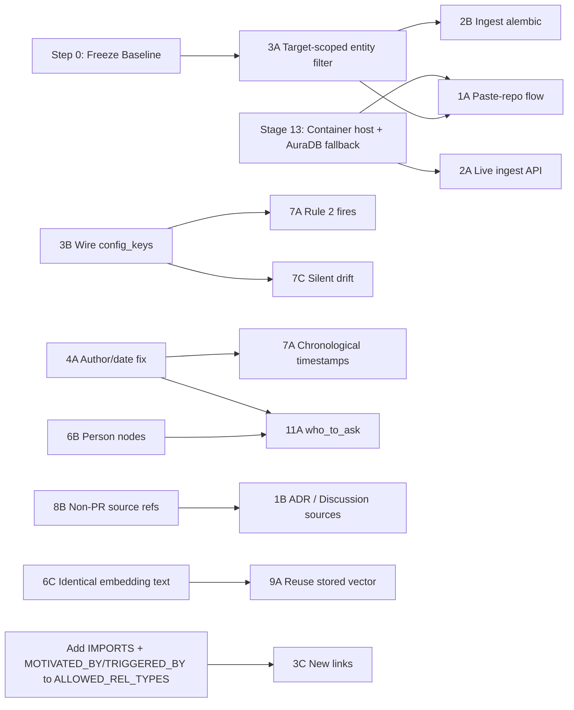

# CodeWhy — 14-Stage Phase-Wise Architecture Plan (`plan.md`)

This document maps CodeWhy across its **14 architectural stages**, incorporating all flaw corrections from [`plan_review.md`](plan_review.md), explicit **P0 / P1 / P2 priorities**, **effort estimates (`S` / `M` / `L`)**, **cross-stage dependencies**, and a **demo-day cut line**.

---

## 0. Execution Order, Priorities & Dependencies

### Priority Cut Line
* **P0 (Must-Have for Demo Day):** Regression baseline freeze, backend container hosting + AuraDB connectivity fallback, Vitest fix, author/date + `who_to_ask`, batched graph rebuild, N+1 & embedding latency fixes, dynamic confidence signals, second repo in SQLite.
* **P1 (Hero Differentiators — Pick 2–3):** Hallucination Duel (side-by-side plain LLM vs. CodeWhy), Line-Level "Why Does This Line Exist?", `codewhy-mcp` live coding-agent demo, Trust Scoreboard eval harness, activating Supersession Rules 2/3/3b.
* **P2 (If Time Remains / Post-Hackathon):** Live Paste-Any-Repo flow with abuse protection & progressive streaming, reference detection for Jira/Linear/Incidents, AST `IMPORTS` blast radius, ellipsis expansion, silent code drift, Auto-ADR export, Time-Travel graph slider.

### Step 0 — Freeze Regression Baseline (`P0`, `S`)
Before modifying Stages 3, 6, 9, or 10 (which affect entity sets, similarity scores, and confidence), capture and freeze:
1. Live `scripts/check_live_answers.py` output across all demo questions.
2. Current recorded fixtures in `frontend/fixtures/recorded/`.
3. Re-run after every stage to catch unintended `full ↔ refusal` flips or headline count drift.

### Cross-Stage Dependency Graph

---

## Stage 1: Sources (GitHub GraphQL API + Local Git History)
**Files:** [`targets.py`](backend/app/services/ingest/targets.py), [`github_client.py`](backend/app/services/ingest/github_client.py), [`github_objects.py`](backend/app/services/ingest/github_objects.py), [`git_probe.py`](backend/app/services/ingest/git_probe.py), [`git_collect.py`](backend/app/services/ingest/git_collect.py), [`targets/`](targets/)

* **Working Baseline:**
  * **GitHub GraphQL API (`https://api.github.com/graphql`):** Fetches Pull Requests (metadata, author, `mergedAt`, up to 100 reviews, 100 review threads, 100 comments, 100 commits, 100 files, 20 closing issues) and Issues in aliased batches of `BATCH_LIMIT = 20`.
  * **Local Git History:** Clones locally, traces target seed files across renames with `git log --follow`, extracts commit metadata/trailers/diffs (capped at 200 KB), and collects local docs (`docs/`, `adr/`, `rfcs/`, `CHANGELOG`, up to 500 KB).
* **Planned Changes, Fixes & Optimizations:**
  * **1A. Zero-Config Auto-Target Discovery (`P2`, `M`):** When a user pastes a GitHub repository URL (`https://github.com/owner/repo` or `owner/repo`) with file inputs left blank, auto-discover the top 5–8 hotspot source files from `git log -n 200 --name-only` (skipping tests/vendor/lockfiles), auto-scan Python files via `ast` for `UPPER_CASE` constants (with regex fallback or explicit Python-first scope for polyglot TS/Go repos so UI isn't silently empty), auto-include `docs/`, `adr/`, `rfcs/`, and auto-save `targets/<owner>__<repo>.json`.
  * **1B. Multi-Source In-Repo & Reference Detection (`P2`, `M`):**
    * *ADR & RFC Collector (`Document` nodes):* Parse `docs/adr/**/*.md` and `rfcs/**/*.md` headers/frontmatter (real text → verifiable quotes).
    * *GitHub Discussions (`Discussion` nodes):* Add GraphQL `discussions(first: 20)` query.
    * *External Ticket & Incident **Reference Detection** (not full API connectors):* Regex detection for Jira/Linear keys (`[A-Z]{2,10}-\d+`) and explicit incident IDs (`INC-\d+`, `SEV-[12]`, `postmortem` — excluding noisy generic words like `hotfix`/`revert` since reverts are handled by Rule 1). Real authenticated Jira/Linear/PagerDuty API connectors remain a post-hackathon roadmap item.
  * **Fresh-Repo Paste Flow — Realistic Timing & Demo Trick (`P2`, `M`):**
    * Pre-flight GraphQL check (~1s) → blobless clone (`git clone --filter=blob:none --no-checkout`, ~3–10s) → **⚡ Quick Start Mode** default in UI: caps at **12–15 high-signal PRs** (respecting Gemini free-tier ~10–15 RPM) with progressive streaming, advertised honestly as **~1–2 min** (with **🔍 Deep Analysis** for 200 PRs).
    * *Demo-safe trick:* Pre-ingest 2–3 popular repos (`urllib3/urllib3`, `sqlalchemy/alembic`, `psf/requests`) so pasting them is an instant cache hit.

---

## Stage 2: Ingest (`scripts/ingest.py` & `data/ingest.sqlite3`)
**Files:** [`scripts/ingest.py`](scripts/ingest.py), [`pipeline.py`](backend/app/services/ingest/pipeline.py), [`sqlite_cache.py`](backend/app/stores/sqlite_cache.py)

* **Working Baseline:**
  * Fetched **294 PRs** and **735 commits** for `urllib3/urllib3`, cached in `data/ingest.sqlite3` with email redaction and resumable skip logic.
* **Planned Changes, Fixes & Optimizations:**
  * **2A. Live Ingest API + `on_progress` Hook + Abuse Guard (`P2`, `M`):** Add `on_progress(stage, current, total, message)` to `run_ingest()` and expose `POST /api/v1/repositories/ingest` + `GET /api/v1/repositories/ingest/{run_id}` (requires container backend host from Stage 13, not Vercel serverless). **Abuse guard:** allow `github.com` only, enforce `max_repo_size_mb`, allow at most 1 concurrent ingest, per-IP rate limit, per-run token cap, and optional demo passcode.
  * **2B. Bundle `sqlalchemy/alembic` in `data/ingest.sqlite3` + Fix Cross-Repo Count Bug (`P0`, `S`):** Scope `cache.count_commit_files(repo)` by `repo` (`pipeline.py:315`), and ingest `sqlalchemy/alembic` into `data/ingest.sqlite3` so 2 full repositories ship out-of-the-box.
  * **2C. SQLite `WAL` Mode + Batched Commit Writes (`P0`, `S`):** Enable `PRAGMA journal_mode=WAL; PRAGMA synchronous=NORMAL;` in `SqliteCache` and batch `put_commit`/`put_commit_file` inside single transactions (~5x faster writes + non-blocking concurrent reads).
  * **2D. Dual Ingestion Modes (`mode="quick"` & `mode="deep"`) (`P2`, `S`):** Quick Start prioritizes PRs linked to auto-discovered hotspot files, revert commits, and ADRs (~12–15 PRs); Deep Analysis runs the full `200` PR / `200` issue sweep and upgrades Quick-Scanned repos without re-fetching cached objects.

---

## Stage 3: Deterministic Linking & Noise Filtering (No LLM)
**Files:** [`linking.py`](backend/app/services/linking.py), [`noise.py`](backend/app/services/noise.py), [`config_keys.py`](backend/app/services/config_keys.py), [`extraction.py`](backend/app/services/extraction.py), [`graph_store.py`](backend/app/stores/graph_store.py)

* **Working Baseline:**
  * Deterministic links (`PART_OF`: 120, `REVERTS`: 7, `CONTAINS`: 4), 10-detector noise filter (70 PRs flagged, revert targets protected), AST constant/config parser written in `config_keys.py`.
* **Planned Changes, Fixes & Optimizations:**
  * **3A. Target-Configurable Source Prefix Filter (`P0`, `S`):** Replace hardcoded `LIBRARY_SOURCE_PREFIX = "src/urllib3/"` in `extraction.py:32-66` with per-repo `include_prefixes` and `exclude_prefixes` in `targets/*.json` (keeping `src/urllib3/` + excluding `src/urllib3/packages/` in `targets/urllib3__urllib3.json` so `urllib3`'s 34 decisions / 24 entities and `test_docs_honesty` / `no-hardcoded-counts` do **not** drift, while `alembic` and pasted repos use their own prefixes or default source exclusions).
  * **3B. Wire Up `config_keys.py` into SQLite (`P1`, `M`):** Call `extract_config_keys_from_source()` and `extract_config_value_changes()` during ingest/linking and persist via `cache.put_config_keys()` and `cache.put_config_value_changes()`. Populates the empty (`0`-row) tables, unlocks Supersession Rule 2 (`2_config_key_changed`), and powers the Visual Constant Evolution Timeline.
  * **3C. Expand `build_links()` to PR Bodies + Register New Rel Types in `ALLOWED_REL_TYPES` (`P2`, `M`):**
    * **Prerequisite fix:** Add `"IMPORTS"` to `ALLOWED_REL_TYPES` in `backend/app/stores/graph_store.py:52-69` (and reuse existing `"MOTIVATED_BY"` or add `"TRIGGERED_BY"` for incidents) so `merge_relationship` never raises on unknown relationship types.
    * Scan PR titles/bodies in `build_links()` for `Reverts #N`, `Fixes #N`, external ticket references, and incident tags.
    * Parse Python `import` statements via `ast` in target files to emit file-to-file `IMPORTS` links (C.1 blast radius).

---

## Stage 4: LLM Extraction (`scripts/extract.py`)
**Files:** [`scripts/extract.py`](scripts/extract.py), [`extraction.py`](backend/app/services/extraction.py), [`extract_decision.py`](backend/app/prompts/extract_decision.py), [`llm_provider.py`](backend/app/providers/llm_provider.py)

* **Working Baseline:**
  * Structured Gemini extraction with `TokenBudget` (`500,000`), prompt-injection sandboxing (`<<<UNTRUSTED_REPOSITORY_DATA>>>`), 96 sources analyzed → 53 extracted (19 unverified excluded).
* **Planned Changes, Fixes & Optimizations:**
  * **4A. Fix `source_author` & `decision_date` Extraction Bugs + Backfill SQLite (`P0`, `S`):**
    * In `scripts/extract.py:641-642`, accept both `str` and `dict` for `raw_payload.get("author")` and read `mergedAt or closedAt or createdAt or created_at`.
    * Backfill existing rows in `data/ingest.sqlite3` directly from `raw_objects` without re-calling the LLM.
  * **4B. Pass PR Reviews & Review Thread Comments into Extraction (`P1`, `S`):** Pass `reviews`, `review_thread_comments`, and `comments` from `raw_payload` into `extract_decisions_from_source(comments=...)` (`scripts/extract.py:653`).
  * **4C. Rate-Limit-Aware Concurrent Extraction (`P1`, `S`):** Use bounded concurrency (`max_workers=3` with RPM pacing / backoff so Gemini free tier ~10–15 RPM does not hit 429 storms) while keeping `TokenBudget` and SQLite writes thread-safe.
  * **4D. Live "Test Extraction & Quote Verifier" Sandbox (`POST /api/v1/extract/preview`) (`P1`, `S`):** Paste any PR body, ADR markdown, or prompt-injection attempt in the UI and watch injection sandboxing, LLM extraction, and verbatim quote verification live in ~3 seconds.

---

## Stage 5: Verbatim Verification Gate (`quote_check.py`)
**Files:** [`quote_check.py`](backend/app/services/quote_check.py), [`extraction.py`](backend/app/services/extraction.py)

* **Working Baseline:**
  * 4-rung normalization ladder (exact, case, whitespace, markdown), canonical offset mapper, sentence completion (`complete_quote`), strict downgrade to `"change recorded, rationale unknown"` when 0 quotes verify (34 verified decisions in `urllib3`).
* **Planned Changes, Fixes & Optimizations:**
  * **5A. Per-Section Quote Attribution (`author` & `timestamp`) (`P1`, `S`):** Match quotes against tagged `(text, section_author, section_timestamp)` sections so review-comment quotes are attributed to the actual reviewer and timestamp rather than the PR author (`extraction.py:441-442`).
  * **5B. Guarded Ellipsis (`...` / `…`) Span Expansion (`P2`, `S`):** If a quote contains `...` with $\ge 20$ chars on both sides matching within $\le 300$ chars in `source_text`, expand to the exact contiguous span, flag `quote_expanded=True`, visually highlight the expanded segment, and **never allow an expanded quote to satisfy Gate G3 on its own** (preserving the 100% verbatim integrity guarantee).
  * **5C. Expose Verification Gate Telemetry (`P1`, `S`):** Surface `rejected_quotes` / blocked unverified decision counts (`53 extracted → 19 blocked → 34 verified`) on the Repository Status API/UI and Trust Scoreboard.

---

## Stage 6: Graph Store (Neo4j AuraDB & InMemoryGraphStore)
**Files:** [`scripts/rebuild_graph.py`](scripts/rebuild_graph.py), [`graph_store.py`](backend/app/stores/graph_store.py), [`schema.py`](backend/app/graph/schema.py), [`embeddings.py`](backend/app/providers/embeddings.py)

* **Working Baseline:**
  * Neo4j AuraDB (~2,056 nodes, 524 relationships) + `InMemoryGraphStore` loaded from `data/ingest.sqlite3`, 8 populated node labels, 7 populated relationship types, 384-dim `all-MiniLM-L6-v2` embeddings.
* **Planned Changes, Fixes & Optimizations:**
  * **6A. Batched Cypher `UNWIND` Rebuild — ~5 Minutes → <10 Seconds (`P0`, `M`):** Add `merge_nodes_batch(label, rows)` and `merge_relationships_batch(rel_type, rows)` (batches of 500 in one session) in `Neo4jGraphStore`, and track inserted node IDs in a local `known_node_ids: set[str]` so `missing_endpoints()` performs **0 network queries**.
  * **6B. Build `Person` Nodes + `AUTHORED` & `REVIEWED` Edges (`P0`, `S`):** Extract PR authors and review/comment authors from `raw_objects`, merge `Person` nodes carrying both `{"id": f"person:{login}", "login": login, "repo": slug}`, and merge `AUTHORED` and `REVIEWED` edges.
  * **6C. Consistent Batch Decision Embeddings (`P0`, `S`):** Use `embedder.embed_batch(...)` during `rebuild_graph.py` over the **exact same text template** used by `retrieval.py` (`f"{summary} {rationale}"` on both sides, or per-entity cached vector), and **verify against the Step 0 frozen baseline** so Gate G4 (`MIN_SCORE = 0.55`) does not flip any demo question outcomes.
  * **6D. Pre-Store Exact Node Counts on `Repository` & `CodeEntity` (`P0`, `S`):** Persist `decisions_count`, `entities_count`, `pull_requests_count`, `commits_count` on `Repository` and `decision_count` on `CodeEntity` during rebuild.

---

## Stage 7: Supersession Engine (`supersession.py` & `state.py`)
**Files:** [`supersession.py`](backend/app/services/supersession.py), [`state.py`](backend/app/services/state.py), [`scripts/rebuild_graph.py`](scripts/rebuild_graph.py)

* **Working Baseline:**
  * Lifecycle states (`ACTIVE`, `SUPERSEDED`, `REJECTED`, `UNRESOLVED`), revert-of-revert reactivation, Rule 1 live on `#3456` superseded by `#3466`.
* **Planned Changes, Fixes & Optimizations:**
  * **7A. Activate Rules 2, 3, and 3b + Fix Chronological Timestamps (`P1`, `S`):** Attach `d["effective_at"] = merged_at_by_source.get(source_id)` *before* `compute_supersession_edges()` in `rebuild_graph.py:393`, check `decision_date` in `_get_timestamp()`, and pass `source_metadata` + `config_changes` so Rules 2, 3, 3b, and `REJECTED` fire on real data.
  * **7B. Persist `probable_superseded_by`, `conflicts_with`, and `reaffirms` on `Decision` Nodes (`P1`, `S`):** Write all three arrays onto `Decision` nodes in `rebuild_graph.py:410-436`.
  * **7C. Honest Silent Code Drift Detection (`check_code_differs_from_latest`) (`P2`, `M`):** Compare latest `ACTIVE` decision's `effective_at` against the newest commit/`ConfigValueChange` on the governed entity. **Honesty guard:** return `None` (unknown) rather than `False` whenever an entity has no commit coverage in the cache, preventing false negatives.

---

## Stage 8: Backend API (`FastAPI /api/v1`)
**Files:** [`main.py`](backend/app/main.py), [`data_source.py`](backend/app/services/data_source.py), [`routes_repositories.py`](backend/app/api/routes_repositories.py), [`routes_decisions.py`](backend/app/api/routes_decisions.py), [`routes_health.py`](backend/app/api/routes_health.py), [`contract/openapi.v1.json`](contract/openapi.v1.json)

* **Working Baseline:**
  * `DataSource` seam (`fixture` vs `graph`), frozen additive-only OpenAPI contract enforced by `test_contract_compat.py`.
* **Planned Changes, Fixes & Optimizations:**
  * **8A. Eliminate N+1 Queries in `data_source.py` (`P0`, `S`):** Check `_has_repository_node()` directly when entity lists aren't needed (`data_source.py:238`), read pre-stored `decision_count`/`verified_decisions` in `search_entities()` (**~4,100 ms → <80 ms**), and read pre-stored node counts in `_repository_response()` (**~1,640 ms → <50 ms**).
  * **8B. Fix `from_source_id()` & `source_ref_for()` for Non-PR Sources (`P1`, `S`):** Support `doc:<repo>:<path>`, `commit:<sha>`, `discussion:<repo>#<num>`, and `incident:<repo>:<id>` so non-PR decisions never raise HTTP 503 (`data_source.py:111-140, 195-210`).
  * **8C. Additive Endpoints (`P1`, `M`):** Add `POST /api/v1/extract/preview` (live sandbox), `POST /api/v1/repositories/{id}/duel` (Hallucination Duel), `GET /api/v1/repositories/{id}/blame` (Line-Level "Why"), and `POST /api/v1/repositories/ingest` (`P2`) — all strictly additive so `test_contract_compat.py` passes. Re-export `contract/openapi.json` and `pnpm run typegen`.
  * **8D. Build `codewhy-mcp` Server (`scripts/mcp_server.py`) (`P1`, `M`):** Expose `codewhy_before_you_change`, `codewhy_ask_why`, `codewhy_who_to_ask`, and `codewhy_search_entities` over **local stdio** by default (or API-key-protected HTTP if remote).

---

## Stage 9: Ask Pipeline (`entity_resolution.py`, `retrieval.py`, `gate.py`, `answer.py`)
**Files:** [`entity_resolution.py`](backend/app/services/entity_resolution.py), [`retrieval.py`](backend/app/services/retrieval.py), [`gate.py`](backend/app/services/gate.py), [`answer.py`](backend/app/services/answer.py), [`coverage.py`](backend/app/services/coverage.py)

* **Working Baseline:**
  * Two-route entity resolution (exact/strong match $\ge 0.85$ + concept text route), 4-gate zero-LLM refusal pipeline (`G1–G4`), double quote verification at answer time.
* **Planned Changes, Fixes & Optimizations:**
  * **9A. Embed Question Once + Reuse Stored `d["embedding"]` (`P0`, `S`):** Compute `q_vec = emb.embed_text(question)` once per `/ask` call and compute `compute_cosine_similarity(q_vec, d["embedding"])` against stored decision vectors (falling back to `emb.embed_text` only when `d.get("embedding")` is missing in unit tests). Cuts retrieval embedding CPU time by **>90%**. Verify against Step 0 baseline.
  * **9B. Skip Redundant Link Re-Fetch & Batch `source_text_for` (`P0`, `S`):** Only call `store.get_links_for_repo(repo)` when a decision lacks pre-computed `state`, and deduplicate `source_id` lookups in `retrieval.py:178-181`.
  * **9C. Expand `PATH_PATTERN` for Polyglot Repos (`P2`, `S`):** Add `.ts`, `.tsx`, `.js`, `.jsx`, `.mjs`, `.go`, `.rs`, `.java`, `.kt`, `.c`, `.cpp`, `.h`, `.cs`, `.rb`, `.php`, `.sh`, `.sql`, `.env`, `.cfg`, `.ini` to `entity_resolution.py:42`.
  * **9D. Thread-Safe Per-Repo LRU `/ask` Cache (`P0`, `S`):** Cache `(repository_id, question.strip().lower(), request.entity_id, repo_last_rebuilt_at)` in `GraphDataSource.ask()` (keyed by that repo's own `last_rebuilt_at` and bypassed while an ingest for that repo is in progress) so demo/repeat answers return in **<15 ms**.

---

## Stage 10: Confidence Scoring (`confidence.py`)
**Files:** [`confidence.py`](backend/app/services/confidence.py), [`answer.py`](backend/app/services/answer.py)

* **Working Baseline:**
  * Formula: $0.30 \cdot D + 0.20 \cdot P + 0.20 \cdot A + 0.15 \cdot R + 0.15 \cdot T - 0.30 \cdot C$, hard-capped at `0.70` on contradiction (`HIGH` $\ge 0.75$, `MEDIUM` $0.50 \dots <0.75$, `LOW` $< 0.50$).
* **Planned Changes, Fixes & Optimizations:**
  * **10A. Dynamic `provenance_from_citations(valid_citations)` (`P0`, `S`):** Replace hardcoded `provenance=0.8` in `answer.py:604`: `1.0` (URL + author + timestamp), `0.9` (URL + author), `0.8` (verified URL baseline floor so clean 1-PR answers stay $\ge 0.75$ `HIGH`), `0.6` (G3 partial).
  * **10B. Dynamic `temporal_consistency_from_bundle(bundle)` (`P0`, `S`):** Replace hardcoded `temporal_consistency=1.0` in `answer.py:607`: `1.0` (clean `ACTIVE` decision(s) and not truncated), **`0.85`** (when `chain_truncated == True` — avoids falsely downgrading long revert chains below `0.75` `HIGH`), `0.50` (when no `ACTIVE` decision exists). Add boundary unit tests.
  * **10C. Human-Readable 6-Signal Breakdown in UI (`P1`, `S`):** Display a 1-line explanation next to each signal in the confidence breakdown card.

---

## Stage 11: `who_to_ask` Contributor Ranking (`who_to_ask.py`)
**Files:** [`who_to_ask.py`](backend/app/services/who_to_ask.py), [`scripts/rebuild_graph.py`](scripts/rebuild_graph.py), [`graph_store.py`](backend/app/stores/graph_store.py)

* **Working Baseline:**
  * 3-tier ranking (`AUTHOR` → `REVIEWER` → `RECENT_CONTRIBUTOR`), bot filtering, 365-day activity window.
* **Planned Changes, Fixes & Optimizations:**
  * **11A. Store `reviewers` on `PullRequest` / `Decision` Nodes & Populate `bundle.sources` (`P0`, `S`):** Persist deduplicated `reviewers` (`login` + `submittedAt`) during `rebuild_graph.py` and populate `bundle.sources` in `retrieve_evidence()`, removing the fragile relative-path `sqlite3.connect("data/ingest.sqlite3")` fallback loop in `who_to_ask.py:138-153`.
  * **11B. Scope `get_people_for_entity(repo, entity_id)` (`P0`, `S`):** Filter `Person` nodes in `graph_store.py:919-923` by `repo` and `entity_id` traversal so multi-repo contributors never leak across repositories.
  * **11C. Include `who_to_ask` on Scored Refusals & G3 Partials (`P0`, `S`):** Populate `who_to_ask` on `no_decision_path`, `low_score`, and `no_verified_quote` responses whenever `resolution.entity` is resolved.

---

## Stage 12: Frontend Workspace (React 19, Vite 8, Tailwind 4, `@xyflow/react`)
**Files:** [`frontend/src/`](frontend/src/), [`frontend/vitest.config.ts`](frontend/vitest.config.ts)

* **Working Baseline:**
  * 6 views (Overview, Investigate, Decisions timeline, Before You Change, Knowledge Graph, Repo Status), honest fixture/data-source banners, OpenAPI contract drift check.
* **Planned Changes, Fixes & Optimizations:**
  * **12A. Fix Vitest JSX Config (`P0`, `S`):** Fix the `ReferenceError: React is not defined` error in `frontend/vitest.config.ts` so all **59/59 frontend tests pass**.
  * **12B. Remove Hardcoded UI Filters (`P0`, `S`):** Remove `ALLOWED_REPOS` in `RepositorySelectorModal.tsx:27` and `src/urllib3/connection.py` exclusion in `DecisionHistoryView.tsx:32`; dynamically generate suggested questions from entity decisions when static demo questions aren't defined.
  * **12C. Hero Demo UI Additions (`P1`, `M`):**
    * **Hallucination Duel View (H1):** Side-by-side plain LLM vs. CodeWhy comparison with unverifiable-claim highlights.
    * **Line-Level "Why Does This Line Exist?" Viewer (H2):** Click any line of a file → `git blame` → PR → Decision → verbatim quote.
    * **Per-Answer Telemetry Chip & Copy AI Guardrails Button:** `"⚡ 1.2s · 812 tokens · 3 verified quotes"` + one-click copy of MCP constraint brief for Cursor/Claude Code.
    * **Modification Risk Badge (`HIGH RISK` / `CAUTION` / `LOW RISK`)** + accessible text labels on confidence/state badges.

---

## Stage 13: Deployment & Configuration
**Files:** [`vercel.json`](vercel.json), [`backend/app/main.py`](backend/app/main.py), [`backend/app/config.py`](backend/app/config.py), [`backend/app/stores/graph_store.py`](backend/app/stores/graph_store.py)

* **Working Baseline:**
  * `vercel.json` currently routes `/api/*` to a Vercel Python serverless function and `/` to Vite frontend; `.env` holds AuraDB and Gemini keys.
* **Critical Fixes (`P0`, `M`):**
  * **13A. Split Hosting — Frontend on Vercel, Backend on Container Host (Cloud Run / Render / Fly.io / Railway):** Vercel serverless cannot run `sentence-transformers` + `torch` (>250 MB), persistent SQLite/git clones, or >60s background ingestions. Deploy FastAPI in a container with a persistent volume for `data/` and point `vercel.json` `/api/*` rewrites at the container URL.
  * **13B. Remove Production Mock Default (`main.py:13-17`):** Do **not** silently default to `ALLOW_MOCK_PROVIDERS=true` / `OFFLINE=true` in production; fail loudly if real LLM credentials are missing, and keep the visible red banner whenever `fixture === true`.
  * **13C. Real AuraDB Connectivity Check + Automatic SQLite Fallback:** In `get_graph_store()`, call `driver.verify_connectivity()` with a ~5s timeout (since the Neo4j driver connects lazily!). If AuraDB is paused (72-hour free-tier idle limit) or unreachable, automatically fall back to loading `data/ingest.sqlite3` into `InMemoryGraphStore` while keeping the **real Gemini LLM and real embeddings**, so the live demo never goes down.
  * **13D. Real `/api/v1/health/dependencies` Readiness Probes:** Report actual store connectivity, node/edge counts, SQLite cache presence, and embedding warm status.

---

## Stage 14: Quality, Evaluation & Verification Suite
**Files:** [`test_contract_compat.py`](backend/tests/unit/test_contract_compat.py), [`verify_phase4.py`](scripts/verify_phase4.py), [`check_live_answers.py`](scripts/check_live_answers.py), [`walkthrough.py`](scripts/walkthrough.py), [`preflight.py`](scripts/preflight.py)

* **Working Baseline:**
  * 1,076 backend tests + 59 frontend tests + 4 live verification scripts + additive-only OpenAPI contract guard.
* **Planned Changes & Additions:**
  * **14A. Trust Scoreboard Eval Harness (`H4`, `P1`, `S`):** A 20–30 question gold dataset (expected `full` / `partial` / `refusal`) computing measurable **Citation Precision (100% verbatim)**, **Refusal Accuracy**, **Hallucinations Blocked** (from `rejected_quotes`), and **p50/p95 Latency** — surfaced in a script and an optional Trust Scoreboard UI view.
  * **14B. Zero-Drift Contract & Honesty Guard (`P0`, `S`):** Run `pytest backend/tests/unit`, `pnpm --dir frontend check`, and `scripts/check_live_answers.py` after every P0/P1 stage to guarantee zero contract regressions.
