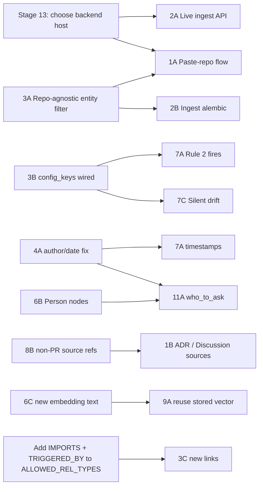

# CodeWhy — `plan.md` Review: Flaws, Hackathon-Winning Features & Recommendations

> [!IMPORTANT]
> **Bottom line:** The plan is technically sound but **over-scoped, unprioritized, and silent on deployment**, which is the stage most likely to sink the demo. It also has several hidden dependencies and a few items that would break at runtime as written. Fix the plan structure first (Section 1), then build the **P0 demo-critical path** (Section 3).

---

## 1. Flaws in `plan.md`

### 1.1 Structural flaws (biggest risk)

| # | Flaw | Why it matters | Fix |
|---|---|---|---|
| S1 | **~45 "LOCKED IN" items, no priority, effort, or owner** | Everything looks equally important; a hackathon team will half-finish many items instead of finishing the demo path. | Tag every item **P0 / P1 / P2** with an effort estimate (S/M/L). See Section 3. |
| S2 | **No hackathon deadline / milestone sequence** | No "what must work by demo day" cut line. | Add a timeline: Day 1 = P0 fixes, Day 2 = hero features, Day 3 = polish + rehearsal. |
| S3 | **Cross-stage dependencies are not written down** | Several items silently depend on others and will fail if built out of order (see 1.2). | Add a dependency graph (below). |
| S4 | **Stage 13 (Deployment) is unaddressed, yet it decides whether the live demo works** | Live repo paste, ingest, and embeddings cannot run on Vercel serverless (see D1). | Decide the backend host **before** building 1A/2A. |
| S5 | **No success metrics / evaluation** | Judges reward measurable claims. "Confidence is a heuristic, not calibrated" is admitted but never addressed. | Add a gold question set + scoreboard (Feature H4). |
| S6 | **No regression baseline before changing core logic** | 3A, 6C, 9A, and 10A/10B all change which answers come back `full` vs. `refusal`. The README, `DEMO_SCRIPT.md`, recorded fixtures, and demo questions all depend on today's outcomes. | Freeze a baseline (`check_live_answers.py` output + fixtures) **before** touching Stages 3, 6, 9, and 10. Re-run after each stage. |

### 1.2 Hidden dependencies (build order matters)

### 1.3 Technical flaws that would break as written

| # | Item | Flaw | Fix |
|---|---|---|---|
| T1 | **3C** `IMPORTS` and `TRIGGERED_BY` links | Neither is in `ALLOWED_REL_TYPES` in [graph_store.py:52-69](backend/app/stores/graph_store.py#L52-L69). `_require_allowed` **raises** on first write, so the rebuild would crash. | Add both to `ALLOWED_REL_TYPES` (and to schema docs). Or reuse the existing `MOTIVATED_BY` for incidents. |
| T2 | **6C + 9A** (embedding text change) | G4's `MIN_SCORE = 0.55` was tuned against today's query-time text. Changing the embedded text shifts every similarity score, so demo questions may flip outcome (e.g., the "Python 2.6" refusal becomes `full`, or vice versa). | Make stored text **byte-identical** to what `retrieval.py` compares today (`f"{ent_name} {summary} {rationale}"`). Note: that is *per-entity*, so either store one vector per (decision, entity) pair or drop `ent_name` from both sides and re-tune. Re-run the baseline. |
| T3 | **1B** Jira / Linear / Incident connectors | There are no API connectors, only regex on IDs like `ENG-1420` / `INC-402`. That creates **empty stub nodes with no text**, so there is nothing to extract and nothing to quote-verify. Calling this a "connector" overpromises. | Rename to **"Reference detection"** for P0/P1. Real connectors (Jira/Linear API + auth) are P2/roadmap. Also, the incident regex terms `hotfix` / `revert` will be very noisy, and `revert` is already handled by Rule 1. |
| T4 | **1A + 9C** polyglot claim | Auto-discovered constants (`ast`) and `IMPORTS` (3C) are **Python-only**. A pasted TS/Go repo gets file entities but no constants and no blast radius, so "Before You Change" looks empty. | Either scope the paste flow to Python repos for the demo, or add a regex-based constant/import extractor for TS/JS/Go as a fallback. |
| T5 | **1A / 2D** "⚡ Quick Start in 30–45s" | Unrealistic as stated: blobless clone (3–10s) + GraphQL (2–5s) + 25 LLM extractions (Gemini free tier is about 10–15 RPM, so `max_workers=5` will hit 429s) + embedding model cold load (15–20s) + rebuild. Realistic: **60–120s**. | Pre-warm embeddings at startup. Budget-check LLM RPM. Cap Quick Start at about 12–15 PRs. Stream results progressively (show decisions as they verify). Advertise "~1–2 min". |
| T6 | **5B** ellipsis expansion | Weakens the core "character-for-character" integrity claim: the expanded span contains text the LLM never claimed, and its `claim` may not be supported by the middle. | Keep, but store `quote_expanded=true`, show the expanded part visually, and **exclude expanded quotes from satisfying G3 on their own**. |
| T7 | **10B** `temporal_consistency = 0.75` on truncated chains | With `A = 0.4` and `R = 0.55`, `T = 0.75` drops the score to about 0.735, which is MEDIUM. Every long revert chain then silently becomes `partial`. | Document this as intended behaviour, or use `0.85`. Add a unit test for the boundary. |
| T8 | **Stage 13** AuraDB fallback | `get_graph_store()` returns `Neo4jGraphStore` whenever credentials exist, and the driver connects **lazily**. A paused AuraDB fails on the *first request*, not at startup, so "fallback on startup" never triggers. | Call `driver.verify_connectivity()` (with a timeout of about 5s) inside `get_graph_store()`, and fall back to SQLite → `InMemoryGraphStore` on failure. |
| T9 | **3A** remove `src/urllib3/` prefix | Changes urllib3's entity set and GOVERNS edges, so headline numbers (34 decisions, 24 entities) and `test_docs_honesty` / `no-hardcoded-counts` / recorded fixtures will drift. | For urllib3, keep the behaviour identical by moving the prefix into `targets/urllib3__urllib3.json` (`include_prefixes`, `exclude_prefixes`). |
| T10 | **7C** silent drift | Commits are only collected for **target files**, and `config_value_changes` only for target-file constants. Drift on any other entity is undetectable, so returning `false` there would be a false negative. | Return `null` (unknown) rather than `false` when the entity has no commit coverage. |
| T11 | **9D** LRU cache | The cache key must include `repository_id`'s own `last_rebuilt_at` (per repo, not global), and the cache must be bypassed while a fresh ingest for that repo is running. | Add both to the spec. |

### 1.4 Deployment & security flaws (missing from plan)

| # | Flaw | Fix |
|---|---|---|
| D1 | **Vercel serverless cannot run the paste-repo flow.** It has no persistent disk (clone and SQLite writes are lost), function timeouts are 10–60s (ingest takes minutes), there are no background jobs, and `sentence-transformers` + `torch` exceed the function bundle size limit (~250 MB). | Keep the **frontend on Vercel** and host the **backend on a container host** (Cloud Run / Render / Fly.io / Railway) with a persistent volume for `data/`. Update `vercel.json` rewrites to point `/api/*` at it. |
| D2 | **Vercel defaults to mock providers** (`main.py:13-17` sets `ALLOW_MOCK_PROVIDERS=true`, `OFFLINE=true`), so judges could see `fixture: true` answers. | Remove the mock default for production, fail loudly, and show a red banner if `fixture` is true. |
| D3 | **Public `/repositories/ingest` = abuse vector**: anyone can burn your GitHub rate limit and LLM budget, or fill the disk. | Allow `github.com` only, enforce `max_repo_size_mb`, run one concurrent ingest, add a per-IP rate limit, a per-run token budget, and an optional demo passcode. |
| D4 | **MCP server exposure** | Run over stdio locally by default. If served over HTTP, require an API key. |

---

## 2. Hackathon-Winning Features (ranked by judge impact ÷ effort)

### 🏆 H1. "Hallucination Duel" — side-by-side vs. a plain LLM *(highest demo impact, ~0.5 day)*
Same question, two panes: **plain LLM** (no retrieval) vs. **CodeWhy**. The plain LLM confidently invents a rationale. CodeWhy cites the verbatim PR quote, or refuses with coverage numbers.
- Reuses the existing `/ask` endpoint plus one raw LLM call.
- Turns the abstract "4-gate refusal" into a 10-second visual "aha".
- Add a "❌ unverifiable claim" highlighter on the plain-LLM side: sentences with no matching source text.

### 🏆 H2. "Why does this line exist?" — line-level blame → decision *(perfect tagline fit, ~1 day)*
The README tagline is *"Every line has a history."* Make it literal: paste a file path and line number (or click a line in a code viewer). Then `git blame -L` → commit → `PART_OF` PR → `Decision` → verified quote.
- The clone is already local (`data/clones/`), and `PART_OF` links already exist (120 in SQLite).
- Strongest possible demo moment: click line 42 of `ssl_.py`, see the RFC 9113 decision **and** its revert.

### 🏆 H3. MCP Server live demo with a real coding agent *(already planned as 8D; make it the finale)*
Show Cursor or Claude Code about to "clean up" `ALPN_PROTOCOLS` in `ssl_.py`. The agent calls `codewhy_before_you_change`, gets *"reverted in #3466 — do not re-enable HTTP/2 ALPN"*, and stops itself.
- This is the **"why it matters in 2026"** story: AI agents break invariants, and CodeWhy is their memory.

### 🏆 H4. Trust Scoreboard (eval harness) *(~0.5 day, big credibility win)*
A 20–30 question gold set (full / partial / refusal expected) with a page showing:
- **Citation precision:** 100% of shown quotes are verbatim (enforced by code).
- **Refusal accuracy:** % of questions that should be refused and were.
- **Hallucinations blocked:** unverified quotes rejected by the gate (from the `rejected_quotes` table, 5C).
- **Latency p50/p95, tokens per answer.**
Judges remember numbers. This also addresses the admitted "uncalibrated confidence" weakness.

### H5. Auto-generated ADRs ("Decision Digest export") *(~0.5 day, clear product value)*
One click generates `docs/adr/0001-*.md` files from the verified decisions (context, decision, status ACTIVE/SUPERSEDED, verbatim evidence, links). Repos without ADRs get them for free from history. This gives a clear "who pays for this" answer.

### H6. Time-Travel Slider on the Knowledge Graph *(~0.5–1 day, very visual)*
Drag a date slider: decisions appear, turn grey when superseded, and reactivate on revert-of-revert. Shows off the supersession state machine (Stage 7), which is otherwise invisible.

### H7. Regression Hotspot Map *(~0.5 day)*
A treemap of files colored by risk: revert count + active constraints + silent drift + unanalyzed PRs. It doubles as the landing visual for a freshly pasted repo, and reuses the risk badge planned in Stage 12.

### H8. `codewhy check` pre-commit / CLI *(~0.5 day; lightweight alternative to the PR bot)*
`codewhy check` reads `git diff --staged`, maps changed files and constants to ACTIVE/SUPERSEDED decisions, and warns: *"You are re-introducing a pattern reverted in #3466."* It delivers the PR-guardrail value without building a GitHub App, and reuses the Pre-Flight Impact Check logic.

---

## 3. Recommended Prioritization (cut line for demo day)

### P0 — Must work for the demo (do first, in this order)
1. **Freeze the regression baseline** (S6).
2. **Pick the backend host + fix D1/D2/T8** (container host, no mock default, AuraDB connectivity fallback).
3. **Fix Vitest** (50/59 failing tests is a bad look if judges run them).
4. **4A** author/date fix + backfill → **6B / 11A–11C** `who_to_ask` populated.
5. **6A** batched rebuild (makes every later iteration fast).
6. **8A + 9A + 9D** latency fixes (sub-second UI, cached demo answers).
7. **10A / 10B** dynamic confidence signals (removes the "hardcoded" criticism).
8. **3A** (via a targets-file prefix, T9) + **2B** second repo in SQLite.

### P1 — Hero features (pick 2–3)
- **H1 Hallucination Duel**, **H2 Line-level "Why"**, **H3 MCP agent demo**, **H4 Trust Scoreboard**.
- **7A** to activate Rules 2/3/3b (needs 3B first). Even one live Rule 2 example strengthens the story.

### P2 — Only if time remains
- Paste-any-repo flow (1A, 2A, 2D), done right with progressive streaming and abuse limits.
- 1B reference detection, 3C `IMPORTS`, 5B ellipsis, 7C drift, H5–H8.
- Real Jira / Linear / PagerDuty connectors (roadmap slide only).

> [!TIP]
> **Demo-safe trick for the paste-repo flow:** pre-ingest 2–3 well-known repos (e.g., `psf/requests`, `pallets/flask`). If a judge pastes one of them, it is an instant cache hit. If they paste something new, stream progress and fall back to "Deep scan queued — here's a pre-ingested repo meanwhile".

---

## 4. More Recommendations (pitch, polish, and rigor)

1. **3-minute demo script, rehearsed:** Hook (AI hallucination, H1) → Ask (`ssl_.py` full answer with verbatim quote) → Revert (supersession) → Refusal (honest coverage) → Agent finale (H3). Keep `DEMO_SCRIPT.md` in sync.
2. **Offline demo mode switch:** a hidden toggle that serves recorded real fixtures if Wi-Fi, Gemini, or AuraDB fails mid-demo, still labelled honestly.
3. **Per-answer telemetry chip:** "⚡ 1.2s · 812 tokens · 3 sources verified". This shows engineering rigor.
4. **Shareable answer permalinks** with a citation "receipt" (good for judges to click after the demo).
5. **Landing-page live counters** from the API: decisions verified, hallucinated quotes blocked, refusals issued. Never hardcode them (the existing `no-hardcoded-counts` test already guards this).
6. **Architecture slide = the 14-stage pipeline**, with "0 LLM tokens on refusal" and "100% verbatim citations" as the two headline invariants.
7. **README:** add a 20-second GIF of H1/H2 at the top, plus a "Run in 2 commands" section.
8. **Business slide:** target users (platform teams, onboarding, AI-agent guardrails), pricing hook (per-repo / per-seat), and the moat (verified provenance graph + refusal discipline).
9. **Accessibility & polish:** keyboard navigation in dialogs already has tests. Make sure the confidence pill and state badges also have text labels, not just color.
10. **Security note in README:** prompt-injection sandboxing, email redaction, no secrets in the repo. Judges increasingly ask about this.
