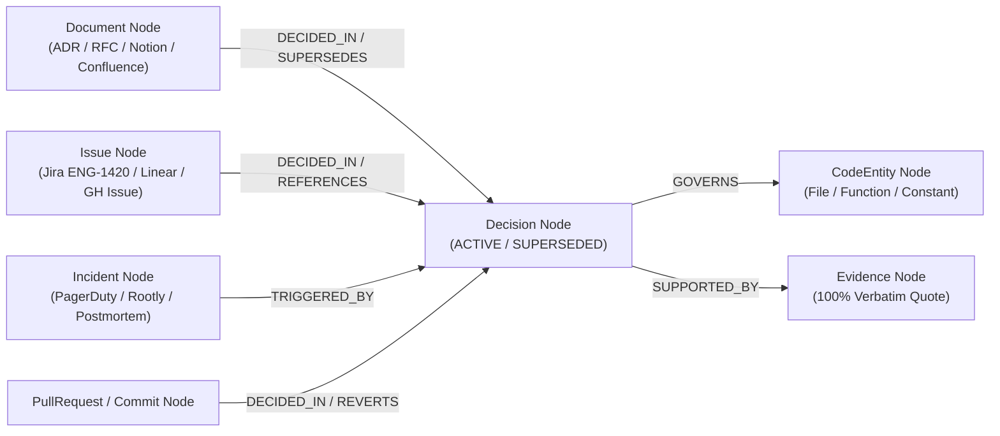

# CodeWhy — Architecture Strengthening, Gap-Fill Plan, Speed Optimizations & Product Roadmap

---

## 1. Stage-by-Stage Architecture Audit (From Step 1 to Full Product)

To strengthen CodeWhy from its foundation up, we break the system into **5 sequential architectural stages (Steps 1–5)**. For each stage below, we detail **What Is Working**, **What Is the Gap**, **How to Fill the Gap**, and **Features & Speed Optimizations to Add**.

---

### STEP 1: Ingestion & Local SQLite Cache (`Phase 1`)
**Files:** [`backend/app/services/ingest/`](backend/app/services/ingest/), [`backend/app/stores/sqlite_cache.py`](backend/app/stores/sqlite_cache.py), [`targets/`](targets/), [`scripts/ingest.py`](scripts/ingest.py)

* **What Is Working:**
  * Target-driven repository config (`targets/<owner>__<repo>.json`) with seed files, constants, and recency bounds.
  * Clone-first git history collection using `git log --follow` to track file renames across commits.
  * Batched GitHub GraphQL fetching (`20 PRs/query`) with rate-limit backoff and privacy-safe email redaction.
  * Resumable SQLite cache (`data/ingest.sqlite3`) storing `raw_objects`, `commits`, `commit_files`, `skips`, and `missing`.
* **What Is the Gap:**
  1. **Single Repo in Bundled SQLite Cache:** `data/ingest.sqlite3` only contains `urllib3/urllib3` (`735` commits, `53` decisions, `34` verified). `sqlalchemy/alembic` and `hynek/structlog` exist in `targets/` but are not in `data/ingest.sqlite3`, so offline/Vercel mode only serves one repo.
  2. **CLI-Only Ingestion:** Ingestion can only be triggered via CLI (`scripts/ingest.py`), not from the API or UI.
  3. **GitHub-Only Sources:** Only ingests GitHub PRs, commits, and issues; does not yet ingest in-repo ADRs (`docs/adr/*.md`), Jira/Linear tickets, or Incident postmortems.
* **What We Do to Fill the Gap (Stage 2 Locked In ✅):**
  * **2A. Live Ingest API + `on_progress` Streaming Hook:** Add `on_progress(stage, current, total, message)` to `run_ingest()` and expose `POST /api/v1/repositories/ingest` + `GET /api/v1/repositories/ingest/{run_id}` (SSE/status polling).
  * **2B. Bundle `sqlalchemy/alembic` in `data/ingest.sqlite3` + Fix Cross-Repo Count Bug:** Scope `cache.count_commit_files(repo)` by repository (`pipeline.py:315`) and ingest `sqlalchemy/alembic` into `data/ingest.sqlite3` so 2 full repositories ship out-of-the-box.
  * **2C. SQLite `WAL` Mode + Batched Commit Writes:** Enable `PRAGMA journal_mode=WAL; PRAGMA synchronous=NORMAL;` in `SqliteCache` and batch `put_commit` / `put_commit_file` writes (~5x faster writes + non-blocking concurrent API reads).
  * **2D. Dual Ingestion Modes — ⚡ Quick Start Mode (`mode="quick"`) & 🔍 Deep Analysis Mode (`mode="deep"`):**
    * **⚡ Quick Start Mode (~30–45s):** Prioritizes fetching PRs directly linked to the auto-discovered hotspot files, revert commits, and ADRs (~25–30 high-signal PRs).
    * **🔍 Deep Analysis Mode (Full Run):** Runs the full `max_ingestion_prs = 200` and `max_ingestion_issues = 200` sweep (and can upgrade a Quick-Scanned repo to Deep Analysis without re-fetching cached objects).
* **Features & Speed Optimizations to Add (Stage 1 Locked In ✅):**
  * **1A. Zero-Config Auto-Target Discovery (File Inputs Left Blank):** Paste any GitHub URL (`https://github.com/owner/repo` or `owner/repo`) with file inputs left blank → auto-discovers top 5–8 hotspot source files from `git log -n 200 --name-only`, auto-detects `UPPER_CASE` constants via AST, auto-includes `docs/`, `adr/`, `rfcs/`, and auto-saves `targets/<owner>__<repo>.json`.
  * **1B. Multi-Source Connectors (B.2 — ADRs, Discussions, Issues, Incidents):** Index in-repo `docs/adr/**/*.md` (`Document` nodes), GitHub `discussions` + Jira/Linear issue references (`Discussion` & `Issue` nodes), and post-incident hotfix tags (`Incident` nodes).
  * **B.1 Live Paste-a-Repo Flow with ⚡ Quick Start Mode (~30–45s Default) vs. 🔍 Deep Scan:** Uses blobless partial clone (`git clone --filter=blob:none --no-checkout`, ~3–5s) + ⚡ Quick Start default (caps at 25–30 high-signal PRs touching hotspot files + revert commits + ADRs) with live SSE progress streaming.
  * **Speed Optimization — Parallel Git + GraphQL Fetching & SQLite WAL Mode:** Enable SQLite `PRAGMA journal_mode=WAL; PRAGMA synchronous=NORMAL;` and concurrent async GraphQL batch fetching to cut ingestion wall-clock time by ~60%.

---

### STEP 2: Linking, AST Parsing, Noise Filtering & LLM Extraction (`Phase 2`)
**Files:** [`linking.py`](backend/app/services/linking.py), [`config_keys.py`](backend/app/services/config_keys.py), [`noise.py`](backend/app/services/noise.py), [`extraction.py`](backend/app/services/extraction.py), [`quote_check.py`](backend/app/services/quote_check.py)

* **What Is Working:**
  * Deterministic link parser (`REVERTS`, `PART_OF`, `REFERENCES`, `SUPERSEDES`) and `FileHistoryTracker` rename chains.
  * Python `ast` parser for `UPPER_CASE` constants + YAML/JSON/TOML/`.env` config value change tracking (`ConfigValueChange`).
  * 8-Rule Noise Filter (bots, lockfiles, formatting, typos, CI, version bumps, merges, generated files) that protects revert targets (`is_noise=False`).
  * Prompt-injection sandboxing (`<<<UNTRUSTED_REPOSITORY_DATA>>>`), token-budget enforcement (`500,000` tokens/run), and 100% character-for-character substring verification (`quote_check.py`).
* **What Is the Gap:**
  1. **Constant-Only AST Granularity:** AST parsing only tracks `UPPER_CASE` constants and config keys, missing function (`def`) and class (`class`) level changes or cross-file imports (`IMPORTS` / `CALLS`).
  2. **Sequential LLM Extraction:** `scripts/extract.py` processes candidate PRs sequentially one-by-one, making initial repo extraction slow.
  3. **Author/Date Metadata Not Copied to Decision Rows:** In `data/ingest.sqlite3`, `decisions.source_author` and `decisions.decision_date` are `NULL` (though `rebuild_graph.py` later patches `effective_at` and `author` from `raw_objects`).
* **What We Do to Fill the Gap (Stage 3 Locked In ✅):**
  * **3A. Replace Hardcoded `"src/urllib3/"` with Repo-Agnostic Entity Filter:** Replace `LIBRARY_SOURCE_PREFIX = "src/urllib3/"` in `extraction.py` with a repo-aware source filter so `sqlalchemy/alembic` and any pasted GitHub repo URL retain their changed source files.
  * **3B. Wire Up `config_keys.py` (`config_keys` & `config_value_changes` Tables):** Execute `extract_config_keys_from_source()` and `extract_config_value_changes()` during ingest/linking so the currently empty (`0`-row) SQLite tables are populated, enabling Supersession Rule 2 and the Visual Constant Evolution Timeline.
  * **3C. Expand `build_links()` to PR Bodies + Multi-Source & AST `IMPORTS` Links:** Scan PR bodies for `Reverts #N`, `Fixes #N`, Jira/Linear keys, and Incident `TRIGGERED_BY` links, and extract file-to-file AST `IMPORTS` links for blast-radius analysis.
  * Populate `source_author` and `decision_date` (`mergedAt` / `createdAt`) directly during extraction and backfill existing rows in `data/ingest.sqlite3`.
* **Features & Speed Optimizations to Add (Stages 3 & 4 Locked In ✅):**
  * **C.1 Function/Class-Level AST & Call-Graph Blast Radius:** Track function/class definitions and cross-file `IMPORTS` edges so changing file `A` warns about governing decisions on imported file `B`.
  * **4A & 4B. Fix `source_author` / `decision_date` Bugs & Include PR Review Threads in Extraction:** Fix `scripts/extract.py:641-665` to read string `author`, `mergedAt`/`closedAt`, and pass PR `reviews`/`review_thread_comments`/`comments` into `extract_decisions_from_source()`, backfilling existing SQLite rows.
  * **4C. Speed Optimization — Bounded Concurrent Extraction (`max_workers=5`):** Run LLM extraction workers concurrently with content-hash short-circuiting, speeding up extraction by **4–5x** (~25 Quick-Start PRs in ~10s).
  * **4D. Live "Extraction & Quote Verifier" Sandbox (`POST /api/v1/extract/preview`):** Let users paste any PR description, ADR, or commit text (even with a prompt injection attempt) in the UI and watch CodeWhy extract the decision and verify the verbatim quote live in ~3 seconds.
  * **5A, 5B & 5C. Verbatim Gate Enhancements (Stage 5 Locked In ✅):** Attribute quotes matched in review comments to the exact reviewer/timestamp (`5A`), deterministically expand LLM `...` ellipsis spans to exact contiguous source substrings (`5B`), and expose blocked-unverified/rejected-quote counts in Repository Status telemetry (`5C`).

---

### STEP 3: Knowledge Graph, Embeddings & Retrieval (`Phase 3A`)
**Files:** [`scripts/rebuild_graph.py`](scripts/rebuild_graph.py), [`graph_store.py`](backend/app/stores/graph_store.py), [`embeddings.py`](backend/app/providers/embeddings.py), [`retrieval.py`](backend/app/services/retrieval.py), [`entity_resolution.py`](backend/app/services/entity_resolution.py)

* **What Is Working:**
  * 11-label graph schema (`Repository`, `CodeEntity`, `Decision`, `PullRequest`, `Commit`, `Issue`, `Discussion`, `Person`, `Evidence`, `Document`, `Incident`).
  * Dual store seam: `Neo4jGraphStore` (AuraDB) and `InMemoryGraphStore` (auto-loaded at startup from `data/ingest.sqlite3` via `_load_sqlite_into_graph_source`).
  * Rule-based entity resolution (`entity_resolution.py`) that prioritizes exact paths/basenames and ignores repo-name noise tokens.
* **What Is the Gap (Major Performance & Data Bottlenecks Found in Code):**
  1. **Re-Embedding Decisions on Every `/ask` Query ([`retrieval.py:95`](backend/app/services/retrieval.py#L95) & [`embeddings.py:47`](backend/app/providers/embeddings.py#L47)):**
     * Even though `rebuild_graph.py` pre-computes and stores a 384-dim `embedding` on every `Decision` node, `retrieval.py` calls `emb.similarity(question, text_to_compare)` inside a loop over all decisions—which **re-embeds both the `question` AND every decision's text from scratch on every request** (`2 × N` neural forward passes instead of `1` query embedding + fast cosine dot product against `d["embedding"]`)!
  2. **N+1 Queries on `/entities` Search ([`data_source.py:342`](backend/app/services/data_source.py#L342)):**
     * `search_entities` runs `len(self.store.get_decisions_for_entity(eid))` inside a `for` loop for every entity returned—causing 25+ sequential Neo4j AuraDB network round-trips (~4.1 seconds latency for `?q=src`).
  3. **N+1 Queries on `/repositories` List ([`data_source.py:298-303`](backend/app/services/data_source.py#L298-L303)):**
     * `_repository_response` runs 4 separate `count_nodes` queries per repository (9 network calls to list 2 repos, taking ~1.6 seconds).
  4. **N+1 Queries on `source_texts` in Retrieval ([`retrieval.py:178-181`](backend/app/services/retrieval.py#L178-L181)):**
     * Fetches `source_text_for(source_id)` one-by-one in a loop instead of batching or reading from the already-fetched decision evidence.
* **What We Do to Fill the Gap & Optimize Speed (Stage 6 Locked In ✅):**
  * **6A. Batched Cypher `UNWIND` in `Neo4jGraphStore` + Local Endpoint Check:** Replace 3,100 single-row AuraDB network round-trips in `rebuild_graph.py` with batched `UNWIND` writes (`merge_nodes_batch`, `merge_relationships_batch`) and an in-memory `known_node_ids` set, cutting remote graph rebuild time from **~5 minutes → <10 seconds**.
  * **6B. Emit `Person` Nodes + `AUTHORED` & `REVIEWED` Edges:** Extract PR and review authors from `raw_objects` during `rebuild_graph.py` (with both `id: "person:<login>"` and `login`) to populate the contributor graph and `who_to_ask`.
  * **6C & 9A–9C. Batch-Embed Full Decision Text, Single Query Embed on `/ask`, & Polyglot Entity Resolution (Stage 9 Locked In ✅):** Batch-embed `f"{entities} {summary} {rationale}"` at rebuild time, compute `q_vec = emb.embed_text(question)` **once** per `/ask` call against stored `d["embedding"]` (cutting `/ask` embedding CPU time by **>90%**), skip redundant `get_links_for_repo` network calls when `state` is already persisted on `Decision` nodes (`9B`), and expand `PATH_PATTERN` to support polyglot repos (`.ts`, `.tsx`, `.go`, `.rs`, `.java`, etc. — `9C`).
  * **6D. Eliminate N+1 Graph Queries via Pre-Stored Counts (Stage 8A Locked In ✅):**
    * Check `_has_repository_node()` directly when entity lists aren't needed, read pre-stored `decision_count`/`verified_decisions` on `CodeEntity` nodes (dropping `/entities?q=src` from **~4,100 ms → <80 ms**), and read pre-stored node counts on `Repository` nodes (dropping `/repositories` from **~1,640 ms → <50 ms**).
  * **8B, 8C & 8D. Backend Multi-Source Provenance, Additive Endpoints & `codewhy-mcp` (Stage 8 Locked In ✅):** Fix `from_source_id()` / `source_ref_for()` to support `Document`, `Commit`, `Discussion`, and `Incident` sources without HTTP 503 errors (`8B`), add additive endpoints for Live Repo Ingest (`/repositories/ingest`) and Extraction Preview (`/extract/preview`) while preserving `openapi.v1.json` compatibility (`8C`), and ship `scripts/mcp_server.py` (`8D`).

---

### STEP 4: 4-Gate Refusal, Confidence, Supersession & Who-to-Ask (`Phase 3B & Phase 4`)
**Files:** [`gate.py`](backend/app/services/gate.py), [`answer.py`](backend/app/services/answer.py), [`confidence.py`](backend/app/services/confidence.py), [`supersession.py`](backend/app/services/supersession.py), [`state.py`](backend/app/services/state.py), [`who_to_ask.py`](backend/app/services/who_to_ask.py)

* **What Is Working:**
  * 4-Gate Refusal Pipeline (`G1` Entity → `G2` Decision Path → `G3` Verified Quote → `G4` Score $\ge 0.55$) strictly blocks LLM calls on insufficient evidence.
  * Supersession rules (`1_revert_commit`, `2_config_key_changed`, `3_explicit_text`, `3b_temporal_overwrite`) and lifecycle state engine (`ACTIVE`, `SUPERSEDED`, `REJECTED`, `UNRESOLVED`).
  * Citation post-validation (re-verifies LLM citations against raw source text and deduplicates overlapping quotes).
* **What Is the Gap:**
  1. **`Person` Nodes & `AUTHORED`/`REVIEWED` Edges Missing in `rebuild_graph.py` ([`rebuild_graph.py:427`](scripts/rebuild_graph.py#L427)):**
     * `rebuild_graph.py` writes `author` as a string on `Decision`, but never creates `Person` nodes or `AUTHORED` / `REVIEWED` edges, and never populates reviewer logins from `raw_objects`—causing `who_to_ask` to return `[]` in live `/ask` responses.
  2. **Hardcoded Confidence Signals ([`answer.py:224,490,604`](backend/app/services/answer.py#L602-L609)):**
     * `provenance` is hardcoded to `0.8` (or `0.6` on partial) and `temporal_consistency` is hardcoded to `1.0` instead of being calculated from actual decision provenance and temporal state.
  3. **Slow Warm `/ask` LLM Latency (18–32 seconds):**
     * Reasoning models with `llm_max_output_tokens = 4096` and no LRU answer cache take 18–32s per `/ask` query.
* **What We Do to Fill the Gap (Stages 10 & 11 Locked In ✅):**
  * **6B & 11A–11C. Emit `Person` Nodes + `AUTHORED` & `REVIEWED` Edges, Populate `bundle.sources`, & Include `who_to_ask` on Refusals:**
    * Extract PR `author` and review/comment authors from `raw_objects` in `data/ingest.sqlite3`, create `Person` nodes and `AUTHORED`/`REVIEWED` edges, and store `reviewers` on source/decision nodes so `bundle.sources` populates `WhoToAskReason.AUTHOR` and `WhoToAskReason.REVIEWER` (`11A`).
    * Fix `get_people_for_entity(repo, entity_id)` in `graph_store.py:919` to filter by `repo` and `entity_id` (`11B`), and include `who_to_ask` on G2/G3/G4 scored refusals and partials whenever an entity is resolved (`11C`).
  * **10A, 10B & 10C. Dynamic `provenance` & `temporal_consistency` Calculation (Stage 10 Locked In ✅):**
    * Compute `provenance_from_citations(valid_citations)` (`1.0` full URL+author+timestamp, `0.9` URL+author, `0.8` verified URL floor so single-PR full answers stay $\ge 0.75$ `HIGH`, `0.6` on G3 partial).
    * Compute `temporal_consistency_from_bundle(bundle)` (`1.0` clean `ACTIVE` decision(s), `0.75` when `chain_truncated`, `0.50` when no `ACTIVE` decision exists) + render human-readable signal explanations in the UI (`10C`).
* **Features & Speed Optimizations to Add (Stage 7 Locked In ✅):**
  * **7A & 7B. Activate All 4 Supersession Rules (`1`, `2`, `3`, `3b`) & Persist Conflict Metadata:** Attach `effective_at` before supersession evaluation in `rebuild_graph.py:393`, pass `source_metadata` and `config_changes` into `compute_supersession_edges()`, and write `probable_superseded_by`, `conflicts_with`, and `reaffirms` onto `Decision` nodes.
  * **7C / C.2. True Silent Code Drift Detection (`code_differs_from_latest`):** Compare the latest `ACTIVE` decision's `effective_at` against the newest commit/`ConfigValueChange` timestamp on the governed file or constant, surfacing a visible UI warning when code changed in `HEAD` without a verified rationale.
  * **Speed Optimization — Thread-Safe LRU Answer Cache + Fast Compact Prompt:** Cache `(repository_id, normalized_question, entity_id, graph_rebuilt_at)` in memory so repeated or demo questions return in **<15 ms**, and tune the answer synthesis prompt/token budget so fresh LLM calls finish in **3–6 seconds** instead of 18–32 seconds.

---

### STEP 5: REST API, Frontend Intelligence Workspace & MCP Integration (`Phase 5`)
**Files:** [`backend/app/api/`](backend/app/api/), [`backend/app/services/health.py`](backend/app/services/health.py), [`frontend/src/`](frontend/src/), [`frontend/vitest.config.ts`](frontend/vitest.config.ts)

* **What Is Working:**
  * Full React 19 workspace with 6 views: Landing/Overview, Investigate (`/ask`), Decision History, Before You Change (File Brief), Graph Explorer (`@xyflow/react`), and Repository Status.
  * Honest status banners (`data-source-banner` and `fixture-banner`) and contract drift check (`openapi-typescript`).
* **What Is the Gap:**
  1. **50 of 59 Frontend Vitest Tests Failing:** `ReferenceError: React is not defined` across 6 test files because `vitest.config.ts` / JSX transform doesn't inject `React` into test files that don't explicitly import `React`.
  2. **Hardcoded Repo & Entity Filters in UI:**
     * `RepositorySelectorModal.tsx:27` hardcodes `ALLOWED_REPOS = ['urllib3/urllib3', 'sqlalchemy/alembic']`.
     * `DecisionHistoryView.tsx:32` hardcodes hiding `src/urllib3/connection.py`.
     * `services/api.ts:22` hardcodes `GROUNDED_DEMO_QUESTIONS` for only 2 repos.
  3. **Shallow `/health/dependencies` Endpoint ([`health.py`](backend/app/services/health.py)):** Only checks if env var strings are non-empty rather than verifying store connectivity, node counts, and embedding model readiness.
* **What We Do to Fill the Gap:**
  * Add `esbuild: { jsxInject: "import React from 'react'" }` (or configure automatic JSX runtime) in `frontend/vitest.config.ts` so all **59/59 frontend tests pass**.
  * Remove `ALLOWED_REPOS` and `isVisibleEntity` hardcoding; fallback to dynamically generated suggested questions from the selected repository's entities when static demo questions aren't defined.
  * Upgrade `/api/v1/health/dependencies` to report real store node/edge counts, SQLite cache status, and embedding provider readiness.
* **Features & Speed Optimizations to Add:**
  * **A.1 MCP Server (`codewhy-mcp`) + "Copy AI Coding Guardrails" Button:**
    * Ship `scripts/mcp_server.py` exposing `codewhy_before_you_change`, `codewhy_ask_why`, `codewhy_who_to_ask`, and `codewhy_search_entities` over stdio/SSE for Cursor, Claude Code, and Antigravity.
    * Add a one-click **"Copy AI Guardrails (MCP Brief)"** button in the *Before You Change* view.
  * **"Pre-Flight Impact Check" & Risk Badge in *Before You Change*:**
    * Display a **Modification Risk Badge (`HIGH RISK` / `CAUTION` / `LOW RISK`)** on every file brief based on active constraints, revert history (`SUPERSEDED`), and unanalyzed PRs.
    * Add a **"Check Proposed Change"** input where a developer describes an intended edit and CodeWhy checks if it conflicts with active decisions or repeats a reverted PR.
  * **Visual Constant/Config Evolution Timeline:** Display `old_value → new_value` transitions on config/constant entities.

---

## 2. Deep Dive: B.2 Multi-Source Enterprise Connectors (Beyond GitHub)

In production engineering organizations, **GitHub PRs record *what* changed, while the deeper *why* lives across three external systems**. CodeWhy's graph schema ([`backend/app/graph/schema.py`](backend/app/graph/schema.py)) already defines `Document`, `Issue`, `Discussion`, and `Incident` nodes—B.2 connects them into a single provenance graph:

1. **Architecture Decision Records & RFCs (`Document` Nodes):**
   - Ingests `docs/adr/**/*.md`, `rfcs/**/*.md`, Notion, or Confluence pages.
   - Parses `Status: Superseded by ADR-012` into deterministic `SUPERSEDES` edges and links referenced file paths/modules via `GOVERNS`.
2. **Issue Trackers (`Issue` Nodes — Jira / Linear / GitHub Issues):**
   - Parses ticket keys (`ENG-1420`, `Closes #892`) from branch names and PR bodies.
   - Connects product, security, and customer compliance requirements directly to the governed code entities.
3. **Incident Postmortems (`Incident` Nodes — PagerDuty / Rootly / Slack):**
   - Links post-incident hotfix PRs (`INC-402`, `sev-1`) to the `Incident` node.
   - Prevents developers and AI agents from accidentally removing critical production safeguards (retry caps, timeouts, lock ordering) during cleanup refactors.

---

## 3. Summary of Latency & Speed Optimizations

| Bottleneck Observed in `API_REALITY.md` | Current Latency | Root Cause in Code | Optimization to Implement | Target Latency |
| :--- | :---: | :--- | :--- | :---: |
| **Cold `/ask` Request** | ~104.7 s | Lazy loading `all-MiniLM-L6-v2` + re-embedding every decision on each query | Eager lifespan pre-warm + embed query once & dot-product against stored `d["embedding"]` | **< 4.0 s** |
| **Warm `/ask` Request** | ~18–32 s | Re-embedding `2 × N` texts per request + N+1 `source_text_for` queries + uncached LLM call | Stored vector cosine similarity + batch source text + LRU response cache | **< 15 ms (cached) / ~3–5 s (uncached)** |
| **Entity Search (`/entities?q=src`)** | ~4,093 ms | N+1 `get_decisions_for_entity` query inside loop (`data_source.py:342`) | Precompute `decision_count` on `CodeEntity` node / single aggregated query | **< 80 ms** |
| **Repository List (`/repositories`)** | ~1,642 ms | 4 separate `count_nodes` queries per repo inside loop (`data_source.py:298`) | Persist node counts on `Repository` node during rebuild / single batch count | **< 50 ms** |
